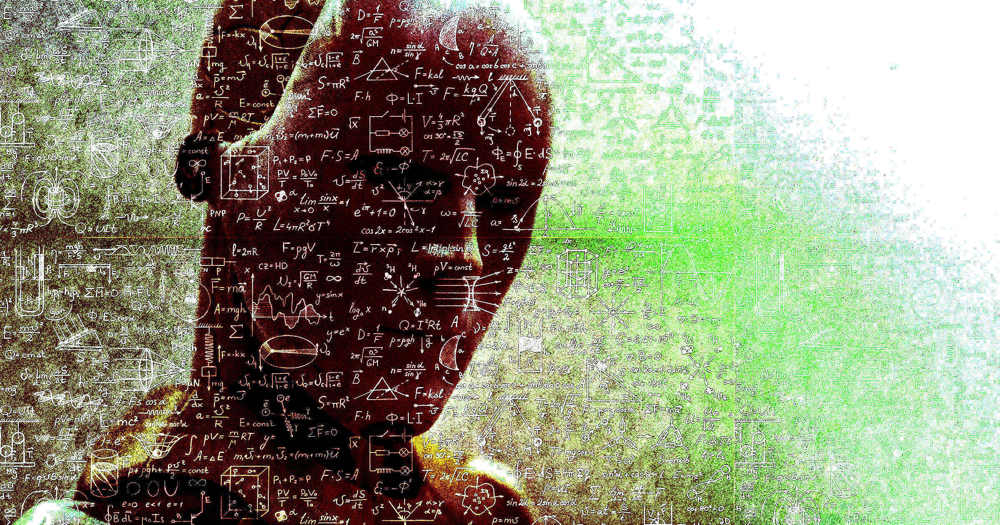

# OpenAI宣称攻克数学难题陷剽窃风波

> OpenAI周二宣布用1万个AI智能体在88小时内"攻克"纳维-斯托克斯方程这一著名数学未解问题，但在正式发布仅数小时前，纽约大学数学家Tristan Buckmaster公开指控其剽窃自己的研究成果——一场围绕"AI抢跑人类科研"的爆炸性丑闻就此引爆。

OpenAI宣称的数学突破，发布前已卷入剽窃指控

## 1万个智能体、88小时、数百万美元

周二，OpenAI对外宣布，它用一群先进AI智能体攻克了一道数学界著名未解难题。但这份荣耀很快变质成一场爆炸性的丑闻——多位数学家公开指责这家公司偷走了他们的研究成果。

OpenAI自称破解的是所谓的纳维-斯托克斯方程(Navier-Stokes)之一。这组微分方程近两个世纪以来一直可靠地描述着从风到洋流的流体如何运动，但科学家长期怀疑存在某些情形，会让它的预测崩坏、描述出物理上不可能的现象。2000年，克莱数学研究所将纳维-斯托克斯列入"千禧年大奖难题"，首个解出者可得100万美元奖金。

OpenAI研究负责人Mark Chen称，公司放出了1万个AI智能体、连续攻关88小时，耗资数百万美元的算力。那堆极其复杂的数学推演最终指向一个场景：方程可以描述出流体加速到无穷大速度的情形——即所谓"爆破"(blowup)或奇点。这在已知物理里不可能发生，因此恰好证明了方程存在崩溃点。

## 数学家抢先一步爆料

但在OpenAI正式发布的前几个小时，纽约大学数学家Tristan Buckmaster已经放出一枚重磅指控。他在OpenAI介入前已研究该问题多年，且即将发表自己的解法。

在一份长篇公开声明中，Buckmaster指控OpenAI的解法与他本人的研究"可疑地相似"，并称OpenAI是在最近得知他和同事、供职于Anthropic的数学家Levent Alpöge取得进展之后，才把资源砸向纳维-斯托克斯的。更添疑云的是，Buckmaster说自己一直在用OpenAI的Codex工具核对工作，暗示公司可能有意或无意读取了他的会话记录照抄过去。他向OpenAI求证时，据称没有得到任何答复。

## OpenAI的回应火上浇油

OpenAI对指控的回应反而让火势更旺。它在否认其研究人员与AI智能体看到过数学家公开发表前的成果的同时，又承认："我们无法排除，源自他们使用我们产品的去标识化数据，帮助改进了我们的模型。"

事情还不止于此。Buckmaster还指控OpenAI数学家Sébastien Bubeck向他施压，要求把Alpöge从论文作者名单中剔除——Buckmaster暗示，原因是Alpöge供职于Anthropic。当他拒绝并威胁要公之于众时，Bubeck据称回了一句："你为什么要毁掉自己的事业？"Bubeck已公开否认这一说法，称其"失实且具有煽动性"。

## 陶哲轩下场炮轰

学界对这一局面普遍感到震惊。著名数学家、微分方程领域的权威泰斗陶哲轩(Terence Tao)痛斥AI正在对这个学科造成伤害。

> "我们现在已经看到，哪怕只是有人正在研究某个问题的传闻，都能触发海量AI算力去把它在原研究项目充分发展之前碾平……激励的方向可能正在变成：不再向更广泛的社区分享任何有前景的研究方向——这会逆转几个世纪以来的开放科学传统，并给这个领域的未来造成严重的长期损害。"——陶哲轩

当算力成了论文的"代笔"，当一条传闻就能调动一万个智能体抢跑，数学界赖以运转数百年的开放传统，正被推向一个危险的拐点。