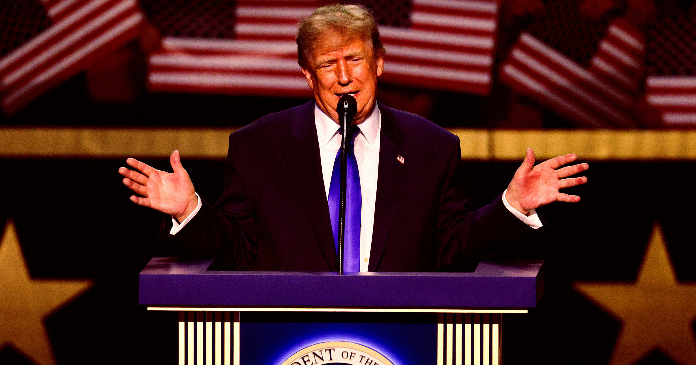

# 特朗普承诺给每个美国成年人发5000美元支票

> 特朗普在达拉斯首届共和党中期大会上承诺：只要共和党拿下参众两院，就给每个美国成年人发放5000美元现金支票。这笔钱按全国成年人口折算，将让纳税人背上1.3万亿美元成本，舆论普遍视之为一次明显的拉票之举。

特朗普在达拉斯共和党中期大会上宣布"发钱"计划

## 达拉斯的一场"造势大会"

民调跌进谷底的美国总统特朗普，又在给美国人民画一张新的现金大饼——而这一张大到离谱。

在得克萨斯州达拉斯举行的首届共和党中期大会上——与其说是正经的党代会，不如说更像一场MAGA造势集会——特朗普向支持者承诺，据BBC报道："如果共和党赢下众议院和参议院……我将向美国每一位成年公民发放5000美元的分红。"

"因为我们干得太好了，因为这个国家赚了太多钱，只有我能向你们许下这个承诺。"特朗普在一段略显含混的讲话中对欢呼的人群说。半岛电视台指出，总统对发放细节语焉不详，只说这笔钱必须花在美国的商品和服务上。"我们不想让你们跑去加拿大花这笔钱。"他警告现场人群。

## 2.7亿张支票，1.3万亿美元

按全美成年人口摊开，这相当于2.7亿张5000美元支票。这对在特朗普反复无常的经济政策下挣扎的工薪家庭而言，无疑是一点喘息——但据半岛电视台测算，这笔钱会立刻让纳税人背上1.3万亿美元的成本，而且还没算上行政开销和对通胀的冲击。

Fortune分析指出，这样的支出几乎会直接砸进美国国家资产负债表——而这张表本就深陷泥潭，每年赤字高达2万亿美元。

## 账很简单，疑问却不少

这笔账其实很好算，但庞大的数字给这笔理论上的支出留下的疑问，比答案还多。比如：既然共和党本就能同时掌控众议院和参议院，为什么不干脆现在就把5000美元发了，直接向选民展示本党能为他们做什么？在特朗普第二任期由食言失信与财务不端串联起来的背景下，各政治光谱的选民对共和党继续"踢皮球"的耐心，正在迅速耗尽。

无论如何，这是一位最近开始相信自己是从世贸中心坍塌废墟中被救出来的80岁老人——换句话说，到了11月，他很可能已经记不起自己许下的这1.3万亿美元承诺了。