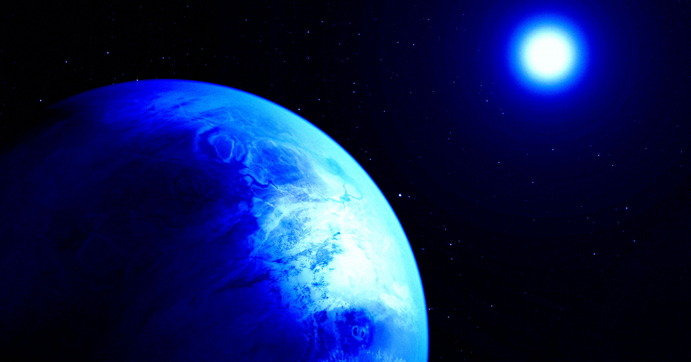

# 地球曾有一颗被太阳吞噬的更大"表亲"，我们可能找到了证据

> 一支天文学家团队认为，地球曾经拥有一个质量更大的"表亲"，而这个岩石世界最终被太阳整个吞下——如今我们或许正从太阳深处读到它留下的化学指纹。

太阳的中心可能藏着被吞噬的超级地球留下的化学印记。图源 Futurism

## 太阳深处，为何藏着莫名的化学谜团？

长久以来，标准太阳模型与对太阳的实际观测之间存在一些说不通的差异：太阳内部的细微结构变化让人费解，锂元素储量也远低于模型预期。发表于《皇家天文学会月刊》（Monthly Notices of the Royal Astronomical Society）的一项新研究提出了一个大胆的解释——年轻的太阳可能吞掉了一颗质量相当于地球5到10倍的超级地球，这些残留的物质至今仍潜伏在对流层之下，留下了"持久的化学印记"。

## 证据藏在声波里

研究团队没有凭空猜测，而是用开源的恒星演化软件 MESA 为太阳建模，再将模型结果与今日对太阳的声学测量相互比对。参与研究的土耳其 Ege 大学学者 Mutlu Yildiz 表示："吞下一颗超级地球，或许就能解释标准太阳模型与观测之间的长期差异，包括太阳内部结构的细微变化，以及锂储量偏低。"

> "吞下一颗超级地球，或许就能解释标准太阳模型与观测之间的长期差异。"
> —— Mutlu Yildiz，土耳其 Ege 大学

## 为什么太阳系偏偏"缺"了超级地球？

如果物质确实被埋藏在太阳对流层之下，锂含量的异常就说得通了——这些被吞下的岩石物质改变了恒星深处的成分与结构。这一解释还顺带回应了另一个宇宙难题：在其他恒星系里，超级地球相当普遍，可我们自己的太阳系却一个都没有。或许它不是从未存在过，而是早已成了太阳内部的一部分。

"下一步，是看这些指纹能否被独立检测到。"如果有一天能通过更精密的观测确认它们的存在，那就等于给这场发生在数十亿年前的"恒星级吞并"补上了最后一块拼图——太阳用无声的包裹，守住了它最古老的一段家族史。