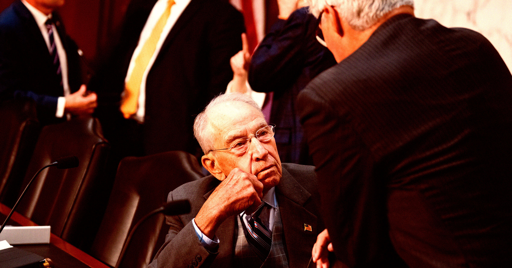

# 年迈的国会似乎完全没准备好监管AI

> 面对来势汹汹的人工智能，美国国会几乎毫无招架之力——十几位议员和幕僚私下抱怨，立法机构里连"紧迫感"都找不到。

图注：年迈的美国国会面对人工智能立法完全手足无措。

## 议员们连"AI"怎么拼都没学明白

一份Politico的深度报道戳穿了国会的窘境：面对人工智能，这个立法机构彻底卡壳了。记者走访了十几位议员和国会助手，他们无一例外地表达了对立法进度迟缓的沮丧——不是分歧太大，而是压根没有动力。

加州民主党众议员山姆·利卡多（Sam Liccardo）说得最直白："有些同事到现在还在学着拼'AI'这两个字母，我们要大幅拉升国会整体的基础知识水平。"话糙理不糙，这并非夸张的修辞。

> "有些同事还在学着拼AI，我们要大幅提升国会的基础知识。"——山姆·利卡多，民主党众议员

## 教育部长把AI念成了"A1"牛排酱

让人啼笑皆非的是，连联邦高层都栽在这上面。去年，教育部长琳达·麦克马洪（Linda McMahon）在一次公开场合反复把"AI"念成"A1"——就像牛排酱的名字一样。一个负责国家教育事务的部长尚且如此，国会里对技术的陌生程度可见一斑。

这种力不从心不是孤立现象。就在最近，Anthropic（OpenAI的最大竞争对手之一）的研究员雅各布·考克森（Jacob Coxon）辞职离开，他在告别信中严厉警告AI公司正在"拿我们的生命赌博"。这封辞职信像一盆冷水，把国会里仅存的那点漠然浇了个透。

## 共和民主两党分歧依旧，法案遥遥无期

共和党参议员特德·克鲁兹（Ted Cruz）态度鲜明，他支持立法防范AI的"灾难性风险"，并点名了参议员图恩（Thune）和克洛布彻（Klobuchar）共同提出的一项两党法案。但问及这法案到底什么时候正式提出，没人能给出一个时间表。

另一边，伯尼·桑德斯（Bernie Sanders）和进步派阵营则更激进，主张直接立法禁止发展"超级智能"AI。一个要限制、一个要封杀，两派各自为政。

德州共和党众议员奇普·罗伊（Chip Roy）的警告尤为扎心："你不可能把头埋进沙子里假装AI不存在。"可问题是，沙滩上的国会，此刻连抬头看一眼的勇气都没有。