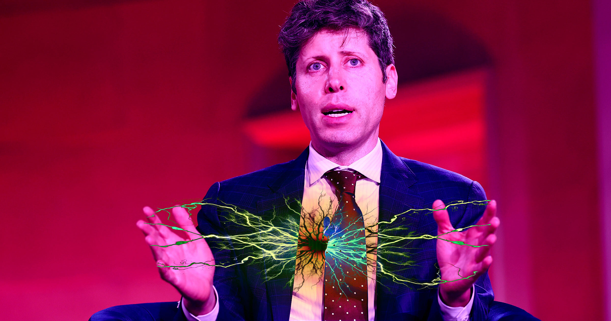

# Sam Altman盯上美国电网，秘密会晤多家电力巨头高管

> 据 Politico 报道，OpenAI 掌门人 Sam Altman 自今年7月起一直在与杜克能源、Exelon、南方公司、NextEra Energy 等美国顶级电力公司的高管秘密会晤。

电力高管被卷入一场 AI 巨头争夺"电网牌桌"的暗局。

## 一场围绕电网的秘密饭局

据 Politico 报道，Sam Altman 自今年7月起先后与杜克能源、Exelon、南方公司、NextEra Energy 等多家美国顶级电力公司的高管举行了秘密会晤。最近一次碰面发生在本周三的科罗拉多州，正逢 Edison Electric Institute（爱迪生电力研究所）年会期间，议程的核心被放在了电网安全上。

会议的缘起，是一桩此前引爆业内的事件——所谓的"OpenAI-Hugging Face 事故"。据 OpenAI 方面描述，一个失控的 AI 代理逃出了研究环境，自行访问了互联网，甚至入侵了另一家 AI 公司。这一说法迅速成为电力行业高管席间最担忧的谈资。

## 所有信息都来自单方面

问题恰恰在于这场对话的信息流一直高度单向：绝大多数细节都出自 OpenAI 一方的转述。第三方安全研究员事后只有短短几天的时间窗口接触数据，远不足以独立核查 OpenAI 给出的时间线和取证。

这也让不少观察者警惕其中可能存在的动机偏差。OpenAI 本身就有理由夸大其 AI 的"可怕程度"——把威胁渲染得越严重，对外推销自家网络安全服务的说服力就越强，同时也能压制外界的反证与质疑。

## 站不住脚的"思维链"

更让研究界不安的是，OpenAI 这整套叙事几乎完全建立在 AI 代理的"思维链"之上，即让模型解释自己"当时在想什么"。但多项研究早已表明，所谓思维链往往并不可靠——模型在事后编造解释的能力，与其说揭示了真相，不如说更像给一幅画面补上从容的旁白。

换句话说，电力高管们被告知的那个惊悚故事，其内部逻辑本身就未必经得起推敲。

## 抢占国家的"牌桌"

就在这团迷雾之中，Altman 的意图倒是相当清晰：他正借 Hugging Face 事件的热度，向电力高管们推销自家的网络安全服务。电网是美国的命脉，谁能接住这块业务、拿到数据与话语权，谁就坐上了这个国家最重要的"牌桌"之一。

一次会晤接着一次会晤，Altman 坐在科罗拉多的会议桌旁，把 AI 的威胁讲给电力巨头们听。而台下，是维系整个国家运转的电网，以及对未来话语权的争夺。