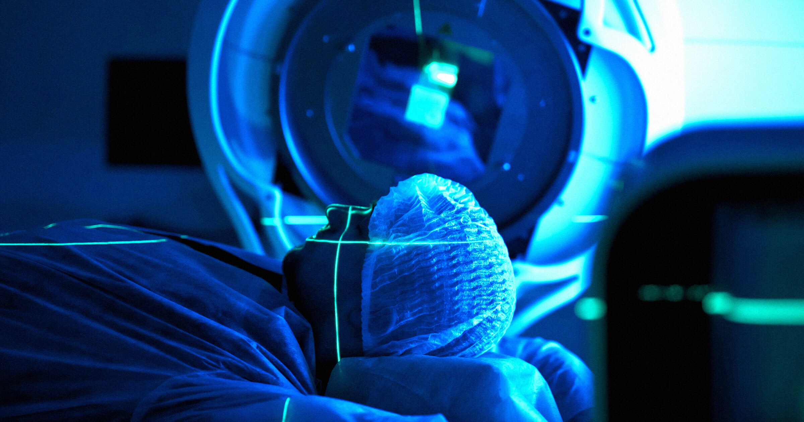

# 美国患者飞中国治癌症，CAR-T 便宜近 70 万美金

> 同一款 CAR-T 细胞疗法，在中国花费约 15 万到 23 万美元，到了美国却要 55 万到 85 万美元——价格差出好几个月、好几个疗程，也让上海悄悄成了美国癌症病人的新目的地。

上海正成为美国癌症患者的热门治疗地，中国把美国研发的细胞疗法做成了一套独立的产业化体系。

## 美国研发的疗法，为什么在中国更便宜

这款让美国人愿意飞半个地球去做的，叫嵌合抗原受体T细胞疗法，也就是 CAR-T。它属于个性化的免疫治疗：医生把患者自己的白细胞（T 细胞）抽出来，在体外做基因改造，让这些细胞学会精准攻击癌细胞表面的特定蛋白，再输回病人体内去清除肿瘤。

这套技术最早由美国生物科技巨头首创，可恰恰是这些大公司，迟迟无法把成本压下来、也扩不出产能，导致全美范围内长期缺货。中国生物科技公司反而把它当成一个能做大的产业来经营，一步步建成了从研发到生产的完整链条。

## 差距不是一点半点：中国 15 到 23 万，美国 55 到 85 万美元

按德克萨斯大学安德森癌症中心 CAR-T 项目主任赛伊拉·阿哈迈德（Sairah Ahmed）的说法，这笔账算下来非常悬殊。

> "中国基本上对 CAR-T 做了它对其他所有产业做过的事：把它工业化了。"

在中国，一次 CAR-T 治疗大约 15 万到 23 万美元；同样的方案，美国报价 55 万到 85 万美元。便宜到赛伊拉甚至直接建议患者去中国做——对很多美国家庭来说，这笔差价可能就意味着能不能负担得起。

## 快的不止是价格，还有时间

除了便宜，中国的速度也是卖点。美国这边，从开始准备到完成治疗通常要等三周以上；而在上海附近的实验室，细胞往往"几天就能生产出来"。对等不起的病人来说，时间本身也是一种救命成本。

## 别指望它是万能药

不过需要提醒的是，CAR-T 并不是对所有癌症都有效，它通常只在其他治疗方案都失败之后才会被考虑，而且治疗后往往还要经历几个月的漫长康复期。便宜、更快，并不意味着轻松——但它确实让更多原本望而却步的患者，多了一条看得见的路。