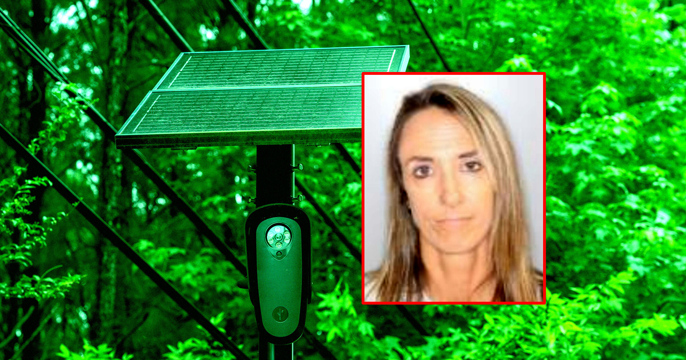

# 资深警探被控两年4000余次非法搜索车牌，仅前女友一人就查了3000次

> 美国奥尔巴尼县一名资深调查员因涉嫌对5个对象进行了超过4000次非法车牌搜索而被捕，其中她前女友的车牌被查询了约3000次。

一名资深调查员因涉嫌违规查询车牌识别系统而被捕，涉案搜索多达数千次。

## 从"杰出员工"到被告席

纽约州奥尔巴尼县警局深陷丑闻。资深调查员劳里·摩尔（Laurie Moore）周三被正式逮捕，罪名涉嫌对5个对象进行数千次非法搜索。据检方透露，这些搜索持续了整整两年，累计超过4000次。

最耐人寻味的是名单里的特殊成员——据信其中一位受害者是她的前女友。仅这一个人，其车牌就被查询了约3000次，占了总数的将近四分之三。

## 轻重罪指控背后的"越界"

摩尔被指控职务行为不当和二级伪造商业记录，两项均为轻罪。但轻罪二字掩盖不了事件的严重性：一名可以合法调取大量敏感数据的执法者，正把权力用在了最不该用的地方。

县警长克雷格·阿普尔（Craig Apple）的回应透着复杂情绪："她是一名杰出的调查员，是我最好的一批员工之一。正因如此，这件事让我心碎。"

## 紧急"收缩权限"

事发后，警局迅速做出调整：撤销非主管人员对Flock车牌识别软件的访问权限，并要求内务部门每30天进行一次审计。这套车牌识别系统（ALPR）本是为破案而设，如今却成了刺向个人隐私的刀。

## 这只是众多案例之一

摩尔并非孤例。就在最近，佐治亚州萨凡纳市也有3名警察和1名职员因类似问题被捕。据美国司法研究所的统计，全国已记录了至少227起ALPR滥用案例——每一次非法查询背后，都是一个毫不知情的普通人，成了系统里那一串被反复拉取的车牌号码。