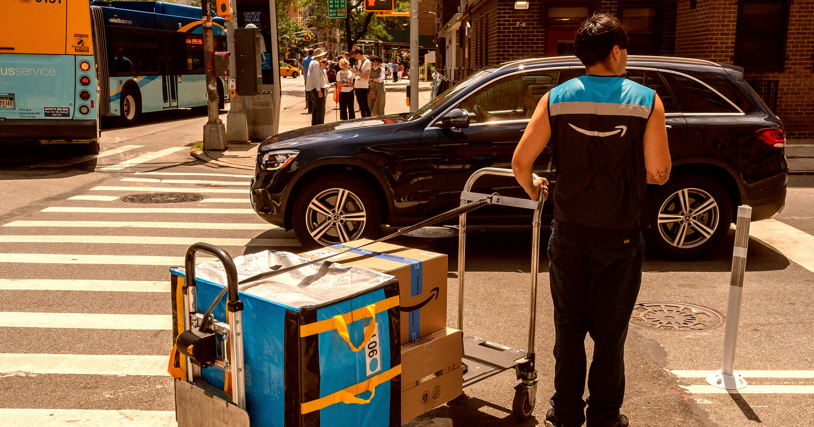

# Amazon被指靠食品券撑起用工帝国：纳税人买单，高管鲸吞利润

> 靠美国政府发食品券和医疗补助过日子的亚马逊员工，2020年到2025年间几乎翻了三倍。同一时期，这家全球最富有公司之一的年利润，却从116亿美元一路涨到777亿美元——批评者说，这等于纳税人用公共资金给亚马逊的用工体系兜底。

亚马逊被质疑用政府补助撑起庞大用工体系，利润与廉价劳动力之间横着一笔隐藏的公共账单。

## 更像公用事业的亚马逊，账单却记在纳税人头上

运营二十多年后，Amazon Prime早已不只是一家电商会员，更像美国商业的"公共基础设施"——它运送的包裹量已经超过美国邮政（USPS），把小商品、建材和日用必需品以破纪录的速度送到小老板、技工和老师手上。

可既然是"公用事业"，它自然带着一份公共报价单。这份账单，最终由美国各地的纳税人承担。

## 关键数字：福利员工翻三倍，利润同样翻着跟头涨

《财富》（Fortune）的最新调查相当刺眼：2020年到2025年间，通过食品券计划（SNAP）和医疗补助（Medicaid）领取政府救助的亚马逊员工，数量几乎翻了三倍。

这一增长发生在一个极其荒诞的背景之下——同一时期，这家超级企业全年利润从2020年的116亿美元，飙升至2025年的777亿美元。

## 里面有具体的钱和人

独立机构美国政府问责署（GAO）拿到的数据显示，在11个州内，有12,346名亚马逊员工靠SNAP补贴购买基本食品，另有11,338名员工依赖Medicaid。

批评者的逻辑很直接：这些联邦援助，实质上是政府对亚马逊劳动力的变相补贴。管理层的天价利润是靠压低的工资堆起来的，而那些最底层的员工，如果不是靠这些政府项目，连基本生活都撑不住。

## 亚马逊不是一个人：沃尔玛、Uber、麦当劳都在列

虽然靠全职员工挣扎的公司远不止亚马逊一家，但GAO的调查显示，亚马逊始终是领用成人SNAP和Medicaid员工人数最多的雇主之一。其他"榜上有名"的还有沃尔玛、Uber这类网约车平台，以及麦当劳、Dollar General等连锁店。

## 更宏大的图景：全世界最富有国家里，每小时都在上班的贫穷

跳出亚马逊，这份调查照出的是全球最富有国家里令人窒息的工薪阶级现实：2024年，全美将近1400万在职成年人参保Medicaid，另有1060万人领取SNAP食品补助。而领食品补助的人里，有71.3%——大约750万人——每周工作35小时以上。

GAO负责教育、劳动力与收入安全事务的主任凯瑟琳·拉林（Kathryn Larin）道破了本质：

> "这份分析真正指向的，是大量收入极低、而且一直停留在极低收入的人群。这些家庭几乎无法维持生计，可他们一直在工作，而且工作得非常努力。"