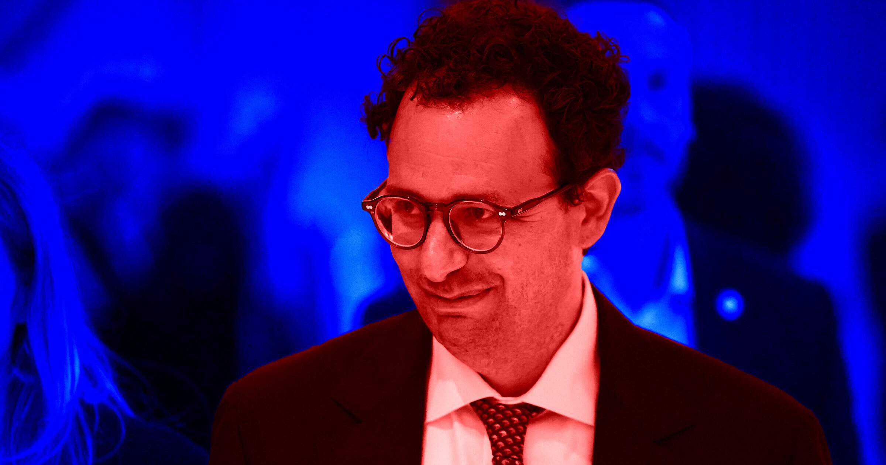

# Anthropic吹嘘不看成本早就盈利

> 据《金融时报》报道，Claude背后的Anthropic告诉一小撮受信任的投资者：公司的调整后经营利润（AOI）即将连续第二个季度转正——前提是撇开研发与AI安全那笔巨额投入。但若看真正的净利润"底线"，这家公司仍亏着数十亿美元。

Anthropic自称撇开成本后早已盈利

## 撇开成本的"盈利"，和真赚钱是两码事

作为全球AI开发领域的顶级玩家之一，私人公司Anthropic至今没能拿出一个季度盈利。这个经营赤字倒不是因为它不努力——按公司自己的说法，局面可能很快就要反转，前提是你愿意吞下一个巨大的附加条件。

据《金融时报》的新报道，开发Claude的这家公司告诉一小批受信任的投资人，其调整后经营利润（AOI）料将连续第二个季度转正。AOI是一套会计技巧，把非经常性成本剥离出去，让出资人得以相当具体地窥探公司内部。靠AOI实现的"盈利"，和靠净利润——也就是常说的"底线"——实现盈利完全是两回事，而看净利润的话，Anthropic仍身处数十亿美元的亏损深渊。

## "哪怕算上研发投入",竞争者也追不上

抛开Anthropic短期内不可能真正盈利的事实不谈，这依然可能是个值得注意的信号。眼下AI世界正充斥着关于AI安全的恐慌情绪，一些分析师认为这或许标志着行业正从"一路卷到地的AGI竞赛"，转向对AI现状更理性——哪怕更少野心——的接受。

这场叙事和商业现实最终会如何落定，还有待观察。但假如美国头部AI公司真的选择停下脚步、让尘埃落定，Anthropic很可能发现自己跑在了竞争对手前面。尽管Anthropic仍深陷亏损，但像ChatGPT开发者OpenAI这样的公司，赔得比它还狠。

SemiAnalysis的首席AI分析师Joey Brookhart对《金融时报》说："如果你继续以这样的利润率和增速经营下去，要想跟Anthropic竞争会极其困难，因为他们手里的算力资源太多了。"

## 盈利预告很漂亮,背后的账却未必做全

不过，这家AI实验室的故事里还有几个悬而未决的问题。比如，这份盈利预测——一个在关键时刻被顺手泄露给财经媒体的好看数字——恰好取代了外界期待已久的一份公开招股书，而那本招股书本应在上周某个时候公布。Anthropic或许还打算尽快放出招股书，但值得注意的是，它选择先拿一场表演和含糊其辞来开道，而不是摆出正式的法律文件。

几个月来，Anthropic一直在拿一场迟迟没有兑现的公开上市吊人胃口，而这次的最新"放慢节奏"讨论会不会影响时间表,仍是未知数。事实上，有理由相信这套唱念做打都是为了给这家AI实验室的IPO做铺垫——毕竟投资人正为AI安全话题兴奋得欲罢不能。

Anthropic的投资人Brad Gerstner上周末在X（原推特）上发文称，Anthropic"终将IPO"，因为"大家对于投资AI领军企业的胃口极大"——尤其是那些被视为给AI领域带来"更多透明、更多审视、更多问责"的公司（至少就Gerstner自己的投资而言是这样）。