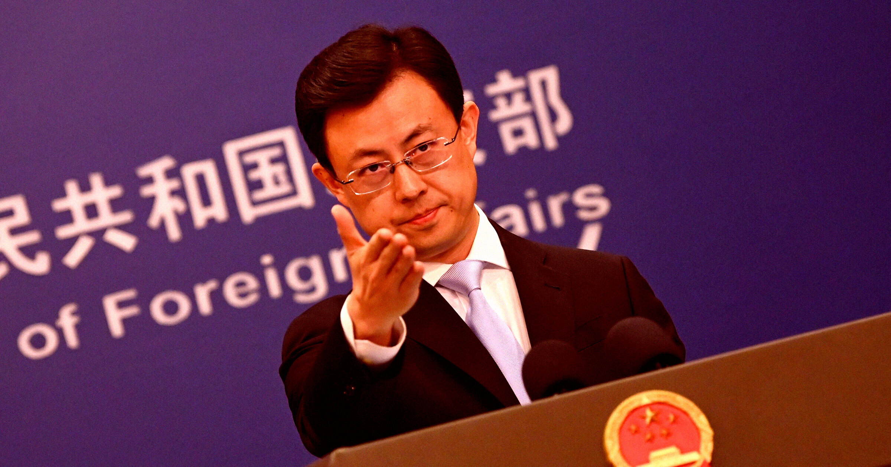

# 中国政府驳回科技富豪喊话暂停AI

> 正当阿莫迪、奥特曼、马斯克等西方科技富豪联手呼吁"暂停AI发展"时，北京给出了一句话回应：恐吓、对抗和恶性竞争只会阻碍全球AI治理，对谁都没好处。

封面图注——相比新闻里其他议题，外交部对这场西方"AI恐慌"的表态简短得近乎冷淡。

## 一场"急转弯"让谁慌了神

过去几年，Dario Amodei、Sam Altman、Elon Musk 这批人几乎把"造出人类级别人工智能"当成神话般的终极目标一路狂飙。然而现在风向突变，这几位西方科技圈的顶级富豪竟然联手，公开呼吁要大幅放缓AI技术的开发速度。

舆论场对这波"急刹车"意见分裂成两极：一边认为这恰好证明AI是真有失控风险、可能威胁全人类生存的实锤；另一边则斥之为烟雾弹，不过是那些AI公司CEO们眼巴巴等着政府来救市、好避免AI投资泡沫破灭的漂亮借口。

## 北京的回答只有三句话

在北京看来，这整件事纯属无稽之谈。

在中国外交部的一场例行记者会上，发言人郭嘉昆挨个回应了一长串议题——从习近平主席访问新德里，到围绕尼泊尔灾难性泥石流的救援工作。在众多提问中，路透社记者问起：外交部对美国科技富豪呼吁放缓AI发展有何评论。

"AI是关乎全人类福祉的重要技术，"郭嘉昆回答说，"各方应共同促进AI造福全人类的开放、包容发展。恐吓、对抗和恶性竞争只会阻碍健全的全球AI治理进程，对各方都无益。"

与那些议题的受重视程度相比，外交部对这场西方AI闹剧的表态显得简短得出奇。明明"AI放缓"的话题已经搅得美国市场震荡、在社交媒体上刷屏，北京这边却似乎只把它当成雷达上的一道微光——不值得大惊小怪。

## 中美眼中的"AGI"根本不是一回事

这番四两拨千斤，与中国决策层对美国AI发展路径一贯的冷淡站位一脉相承。美国这边很多年都把AI押在"造出通用人工智能"的赛道上。

布鲁金斯学会研究员 Kyle Chan 今年二月就指出，北京所说的"AGI"，跟大洋彼岸用的根本不是同一个概念。美国决策者和产业领袖把AI看作一场逐鹿AGI的竞赛，赢者通吃；中国同行却明显不急。即便美国先跑到终点也没关系，就像电动车、癌症疗法和智能手机一样，中国产业界很快就能后来居上。

"看看互联网的历史。它起源于美国，但中国很快迎头赶上，并在消费应用上走到前列——微信就是世界级的例子，"香港科技大学荣休教授杨强在一月AGI Next峰会的小组讨论上说，"AI也类似——它是一件工具，中国的创造力会把它推到极限。"

于是，当西方在"要不要踩刹车"的焦虑里内耗，中国人已经把手放到了油门上——他们赌的不是眼前谁跑第一，而是这辆车最终能开多远。