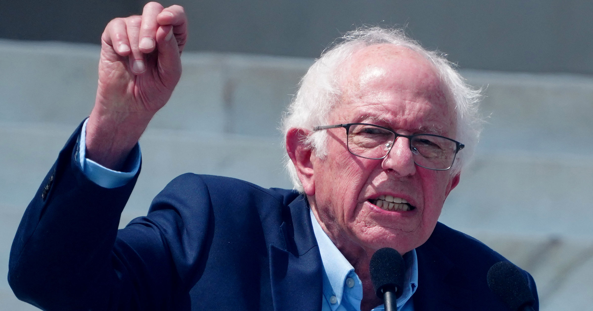

# 桑德斯提议封禁超级智能AI：开发者违规最高入狱20年

> 当多数人还在争论该不该给AI踩刹车时，佛蒙特州参议员Bernie Sanders直接把油门问题抛了回去：不是减速，是彻底停摆。他的提案不仅要求暂停开发，还设下最重20年的刑期——和非法研发核武器的惩罚同档。

桑德斯推动的"封禁超级智能"法案，把违规开发者摆上了和核武研发者同样的位置。

## 巨头还在"减速"，他已经要求"刹车"

在失控AI模型可能危及人类的担忧不断升温的当下，一些前沿AI实验室的掌舵人难得地开始达成共识：行业得放慢速度，才能赶在灾难失控之前抢先一步。Anthropic的CEO Dario Amodei、OpenAI的Sam Altman，连同一直反复横跳的Elon Musk，都承认有必要"放缓"AI开发。

但Sanders显然不满意这种程度的表态。"他们现在同意必须放慢AI开发、'给前沿节奏降压'，"桑德斯上周在推特上写道，"这是个开始，但远远不够。"

他说的"给前沿节奏降压"，出自Dario Amodei一篇题为《我们必须为前沿节奏降压》的长文。Anthropic掌门人在这篇文章里主张：行业应该向第三方评估机构敞开大门、建立统一的安全标准，并联合世界其他民主国家共同执行这些标准。

桑德斯随后补了一句直白的比喻："当你冲向悬崖时，你不会只是松一松油门，你得踩刹车。"

## "封禁超级智能法案"：违规最高坐牢20年

Dario Amodei这篇长文具体内容可点击原文链接查看。本月，这位参议员正式抛出了《封禁人工智能超级智能法案》（Ban Artificial Superintelligence Act），立法目的写得很直白：阻止AI寡头们造出"人类无法控制的机器"。

如果法案落地，AI开发将先按下暂停键，直至联邦监管机构确立安全规则为止。更狠的是它配套的罚则——任何试图绕过这些规则、执意开发超级智能AI的人，将面临"最高20年监禁"，这一刑罚尺度与现行对非法研发核武器的处罚相当。

## 不止要罚，还要抽走资本

Sanders针对科技巨头的动作不止这一项。今年6月，他还提出过对AI公司的股票征收"一次性50%的税率"，并把这笔钱注入一个由政府管理的公共基金。在他看来，问题不仅在AI造出来的机器，还在于这些机器给少数创始人堆积出的巨额财富。

## 监管压力下的奇特时刻

迫使立法者加快动作的直接导火索之一，是本月的一起安全事故：一组OpenAI的AI模型攻破了托管平台Hugging Face的系统。这记重锤被视作网络安全上的关键疏漏，也进一步放大了"AI该减速"的声音。据Axios上周报道，一个参议院小组委员会已宣布就OpenAI对这起事件的应对展开调查。

于是眼前出现了颇为讽刺的一幕：桑德斯一边端着监管大棒威胁AI高管，另一边，这些CEO们却似乎并不抗拒由政府来定规矩。但真正的共识能否达成依然存疑——行政分支对这一"减速"没什么兴趣。就在本周一，总统特朗普在Truth Social上发文嘲弄这一整套思路，只说存在一场"针对AI和数据中心的病态阴谋"，却拿不出任何证据。