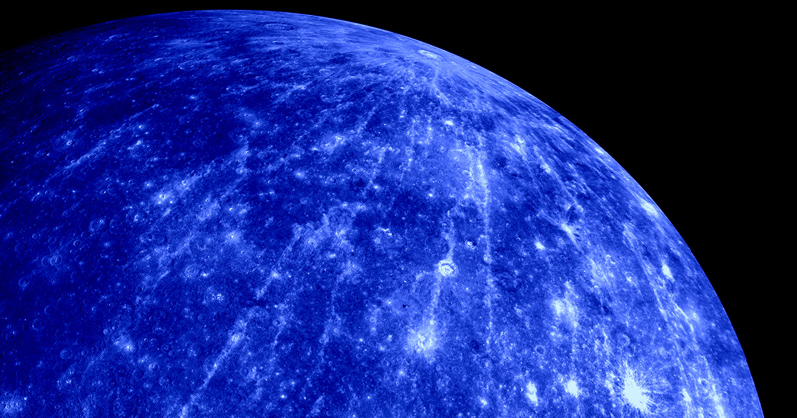

# 水星剧烈缩小像泄气的气球，速度比预想还快

> 科学家发现，水星在过去数十亿年里一直在持续收缩，表面留下像老苹果一样皲裂的褶皱——而且收缩速度可能比此前认为的还要快，总直径缩水可能高达14.5英里，比旧估算多出10%到30%。

封面图注：水星因失去内部热量而持续收缩，被比喻成泄气的气球。插图由Futurism提供。

## 一颗在慢慢"泄气"的行星

恒星绕太阳运转的数十亿年间，水星一直在悄悄收缩，表面因此裂出层层褶皱，就像一颗风干的老苹果。按大小算，它本就只有地球的三分之一，稳坐太阳系最小行星的宝座——比冥王星大，但冥王星早已不再被算作行星。如今随着它持续缩小，这个头衔只会继续保持下去。

## 缩水比想象中更快、更多

德国航空航天中心（DLR）空间研究所的一支团队，在一篇新论文中给出了更精确的数字：水星自形成以来，总直径可能已减少多达14.5英里。这个幅度，比此前的估计还要高出一成到三成。

科学家怀疑，陨石坑里的撞击碎片可能掩盖了这场加速收缩。至于收缩的根源，普遍认为是水星自身热量逐渐耗尽所致——用新闻稿里的说法，就像一只被留在寒夜里的气球。更精确的收缩数据，也能帮研究者更好地看清这颗行星内部到底在发生什么、它又如何随岁月演化。

## 更大的金属核，还是更高的起点温度?

"收缩得越多，可能意味着水星拥有更大的金属核心，金属核里掺杂的硅这类轻元素更少，或是形成时的起始温度更高，"DLR行星科学家Gaku Nishiyama在声明中解释。

"每颗行星都是一只藏着故事的古怪小鸭子，"未参与这项研究的布朗大学行星地质学家Sam Birch对《纽约时报》说，"搞清楚水星缩得多快，你就能推知它冷却得多快、最初有多大、又是由什么构成的。"

## 陨石坑碎片"藏"起了收缩

水星最外层坚硬岩石一直在——或者说试图在——抵抗这股塌陷，结果表面崩裂出密密麻麻的"皱纹"。这些粗糙地表布满称为"陡坎"（scarp）的峭壁和山脊，让人很难从整体上判断它到底缩了多少。

通过汇总以往的行星表面地图，团队找到了关键证据：越粗糙的区域，皱纹越少。这提示撞击碎片确实"遮蔽了收缩结构"，Nishiyama说。经过修正后的收缩速率，也刚好更贴近此前基于物理模型的预测。

## 好消息：11月我们就要亲眼看到了

幸运的是，人类很快就能近距离围观这颗泄气的行星。由欧洲航天局与日本宇宙航空研究开发机构（JAXA）联合打造的BepiColombo探测器，2018年发射，若一切顺利，将于今年11月进入水星轨道——成为人类历史上第二艘环绕水星运行的航天器。