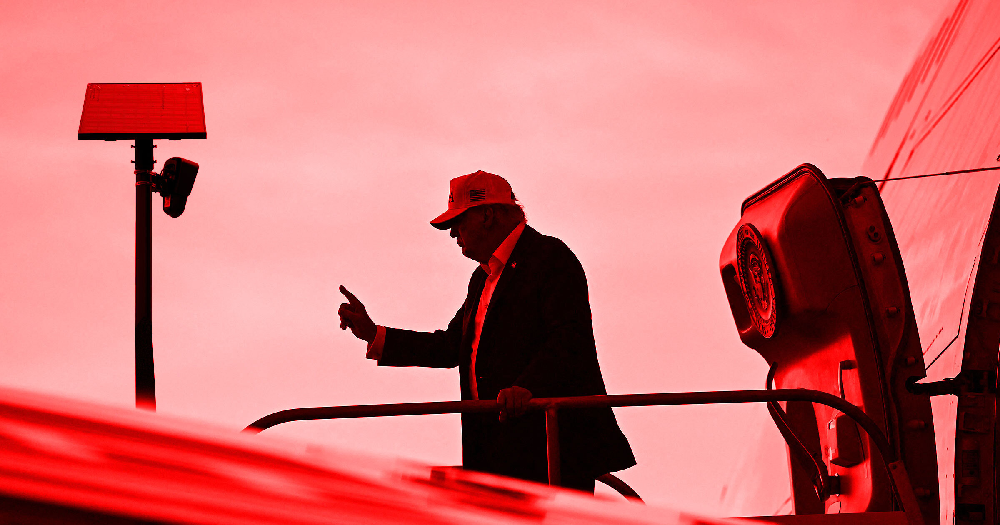

# 特朗普公开力挺Flock摄像头：口碑跌到谷底之时，他却站了出来

> 美国总统特朗普首次公开力挺Flock Safety这家"深入人心的反感"的监控公司——一个由超过12万台AI摄像头和车牌扫描设备组成的全国监控网络。值得注意的是，他给出的支持理由既没有谈安全，也没有回应隐私担忧，而这恰恰是特朗普式决策的典型注脚。

特朗普公开站台的车牌识别监控网络，正深陷滥用丑闻与舆论公愤之中。

## 一句"我喜欢它们"，成为公开背书

特朗普对Flock的支持，来得直接又含糊。周日他对记者表示："我有点喜欢它们，因为执法，但有些人不。他们认为这是一种侵犯。"说到Flock的批评者时，他补了一句："我喜欢它们。"

这是特朗普首次公开力挺Flock。据《华盛顿邮报》报道，就在上个月，他对这项技术还表现得相当谨慎，被问及看法时拒绝给出正面回答。

## 120万台摄像头的网络安全吗？答案让美国人警觉

过去一年，Flock已经成了政坛上的一颗"雷"。越来越多的美国人担忧，一个集中且强大的监控网络正悄无声息地蔓延进自己的社区，却几乎没有任何公开监督。

注意力的焦点落在它的滥用上。Flock把自己包装成"严格用于执法道路违章、抓捕犯罪"的工具，但它的摄像头网络规模超过12万台——一位《华盛顿邮报》调查记者发现，警察滥用Flock摄像头及类似系统的案例超过50起，其中包括用来跟踪女性。

还有系统本身出错、操作不当的例子：包括一名记者在内的无辜者，曾被全副武装的警察团团围住。这家公司激起的反感甚至到了这种程度——在俄亥俄州，一个大陪审团拒绝起诉一名被拍到砸毁Flock监控杆的男子，尽管监控画面把他抓了个正着。

## 公司CEO刚道过歉，特朗普就来站台

换句话说，特朗普的背书，正落在Flock声誉的绝对低谷。上个月，在《华盛顿邮报》调查曝光系统频繁被滥用之后，其CEO Garrett Langley被迫公开道歉。随后他又坚称公司"不是老大哥"，还试图用"妥协"的逻辑说服批评者，称要在隐私和安全之间找到平衡。

特朗普选择在这个节骨眼上全力支持，却连一句敷衍的安全表态或对美国人隐私的关切都没提。这种姿态十足"特朗普"——他已经很久不把舆论放在眼里了。他对数据中心的全力支持（那比Flock还要不受欢迎）就是另一个类似注脚。

## 连共和党盟友都在退避

即便如此，连特朗普自己的共和党盟友都持更谨慎的立场。上个月，佛罗里达州州长Ron DeSantis说这些摄像头已经"失去控制"，并直言不希望"这变成一个监控国家"。

一边是CEO被迫弯腰道歉、民间公愤堆积成山，另一边是总统高调背书、盟友委婉撤身——围绕这套车牌识别监控网络的拉锯战，恐怕才刚刚拉开序幕。