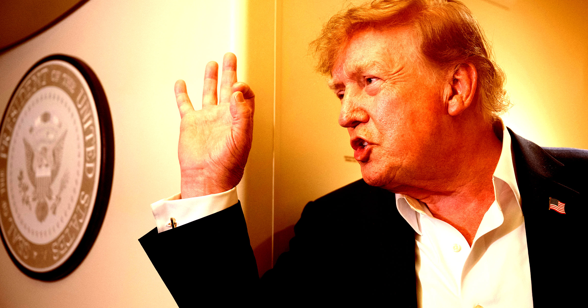

# 特朗普对AI减速的胡言乱语可能真要命

> 周末，Anthropic CEO Dario Amodei、马斯克、OpenAI CEO Sam Altman 接连呼吁给前沿AI"踩刹车"，特朗普却公开唱反调——还把呼吁减速的人骂成"完美小天使"。当全行业都在认真讨论"失控AI"几乎不可避免时，这位80岁总统的AI至上论，可能正把人类推向真正的危险。

特朗普在周末公开反对AI减速，与硅谷高层呼吁审慎的主流声音针锋相对。

## 硅谷集体踩刹车，特朗普泼冷水

整个硅谷想给AI减速的心思已经藏不住了。这周末，Anthropic CEO 达里奥·阿莫迪（Dario Amodei）加入马斯克和 OpenAI CEO 山姆·奥特曼的行列，一起呼吁放慢前沿AI模型的开发。而这距离 Anthropic 研究员 Jacob Coxon 宣布离职没几天——他辞职时就公开指责，Anthropic 和前东家 OpenAI 都没有"负责任地行事"。

今年一连串黑客攻击事件之后，一台失控AI大闹天下的威胁，已经从脚注式的"万一"变成了全行业高层认真讨论的话题。可他们现在撞上了一个强硬的对手：特朗普在周末公开抨击"AI减速"这个想法。

对这位总统来说，美国还陷在一场激烈的大国竞赛里——这场竞赛似乎压过了他关于安全的任何顾虑。

## "我们要保持领先中国"

特朗普在一场高尔夫锦标赛上放话，被《华盛顿邮报》引用：

> "我们在AI上领先中国，我们是全世界最先进的国家，老实说我想继续保持这样。"

他还在 Truth Social 上发了一篇语无伦次的帖子，指责阿莫迪"装得像个完美小天使"，并坚称美国对这些公司"拥有巨大的刑事和监管权力！"

> "有一场针对AI和数据中心的可恶阴谋正在上演，唯一为此高兴的是中国。谁赢得AI，谁就赢！我们领先中国和所有其他国家，而且将继续领先。"

## "AI至上"的叙事，越来越难卖了

特朗普的第二个任期，大部分时间都在吹捧AI产业：一手促成数十亿美元的交易，还撤掉拜登时代的AI规则和环境监管等一道道监管门槛，好取悦各路老板。可现在，"失控AI反噬人类"成了专家们几乎当作板上钉钉、煞有介事在讨论的话题——他的AI至上论就越来越难站住脚了。

更糟的是，总统还在暗示存在一个针对硅谷的地下阴谋集团——却似乎没意识到，呼吁加强监管的恰恰是科技行业自己。

> "我觉得有很多负面的力量在挑起这些事，它们不该提的。它们提的都是不会发生的事。"

不过，特朗普显然也没把这个立场贯彻到底——他在压力面前素来有惯于妥协的名声。被问到科技高管们再次呼吁减速时，他后来对白宫记者改口：

> "我不是在轻描淡写。但这件事利大于弊——而且是大得多。"

## 另一边，政客却在朝同一个方向靠拢

和总统唱反调的是，另一边的政客们正在联合呼吁减速或暂停AI开发。这件事的赌注不比别的：AI议题很可能会影响接下来的中期选举，也和美国民众对数据中心的怨气正好撞在一起——而那些数据中心，恰恰是总统鼎力支持的基建项目。