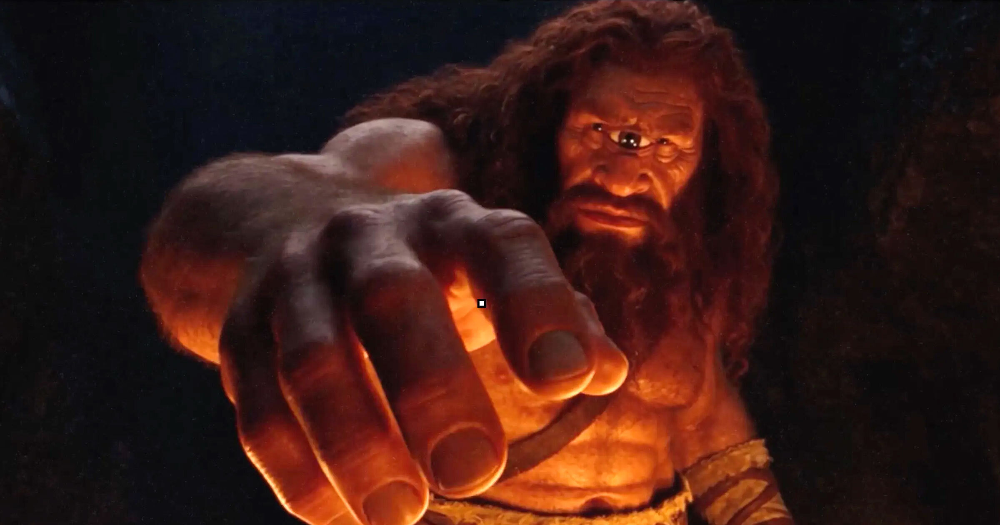

# 马斯克AI奥德赛大赛冠军让人捧腹

> 还记得马斯克放话要让他的AI「Grok」拍一版「反觉醒、历史准确」的《奥德赛》吗？他为这事干脆办了一场比赛，而拿下一等奖10万美元的作品，正如你想的那样，是一堆让人捧腹的垃圾。

马斯克举办的AI《奥德赛》大赛冠军作品，几乎每一帧都在挑战观众的忍耐力。

## 「波吕斐摩斯有三只眼睛」

问题从根子上就歪了。独眼巨人波吕斐摩斯在片中被画出了三只眼睛——对于这位以独眼著称的巨兽，这几乎可以直接判出局。更离谱的是，才过了几个镜头，这个本就该只有一只眼的巨人，体型又暴涨到之前的四倍以上。

片中的其他神魔看起来像从手机游戏里跑出来的。波塞冬从海里钻出来时，浑身卡通味十足、肌肉夸张到不科学，随后噼里啪啦砸了奥德修斯的船，顺带干翻一船「写实肌肉男」船员。

## 除了空洞，还是空洞

台词里有一半是用一种戏剧化的气声念出来的，而且腔调高度一致。打斗场面被精心剪掉真正撞击的瞬间，这套手法，正是老B片对付年迈动作明星的惯用伎俩。

零星几个镜头乍看还能唬人，但前提是你得忽略它们平淡无趣的审美。这部「AI电影」和所有AI电影一样，栽在同一个致命伤上：片段剪辑各自为政，根本拼不成一个连贯的整体。至于「历史准确」——也没好到哪去，片里一些希腊士兵，穿的明显是罗马军团士兵的铠甲。

## 「荷马若有知……」创作者自己都上头了

即便如此，创作者Nem Perez还是宣称「这就是荷马想要的《奥德赛》」，并称之为自己「迄今为止最精雕细琢的作品」。他还给这支视频贴了个自相矛盾的标签——「五分钟史诗」。

有意思的是，马斯克到底有没有看过这个冠军作品，目前存疑。据我们查证，他既没回复也没转推，而之前其他AI版《奥德赛》他是转过的。

## 一场夏天延续到秋的文化战争

这段插曲的背景，是马斯克整个夏天都在跟克里斯托弗·诺兰版的《奥德赛》互喷。他对那版的多族群选角——包括几位黑人女性演员和一位跨性别演员——发起了猛烈攻击，指责诺兰「亵渎了荷马，为了拿奥斯卡不惜跪舔觉醒规则」。他随即立誓，要用AI「Grok Imagine」拍一版「历史准确、忠于荷马艺术」的长片《奥德赛》。

那部长片，我们至今还在等。但比赛产出的这些短片已经足以说明问题：AI视频生成器，以及痴迷于它们的所谓「电影人」，根本接不住这活儿。三强作品里，奥德修斯看起来几乎是同一个人——某个「颜控改造党」幻想出来的、一身腱子肉的安东尼奥·班德拉斯。这锅该扣在Grok头上，还是Grok的用户头上？到这个份上，区分起来已经没什么意义了。