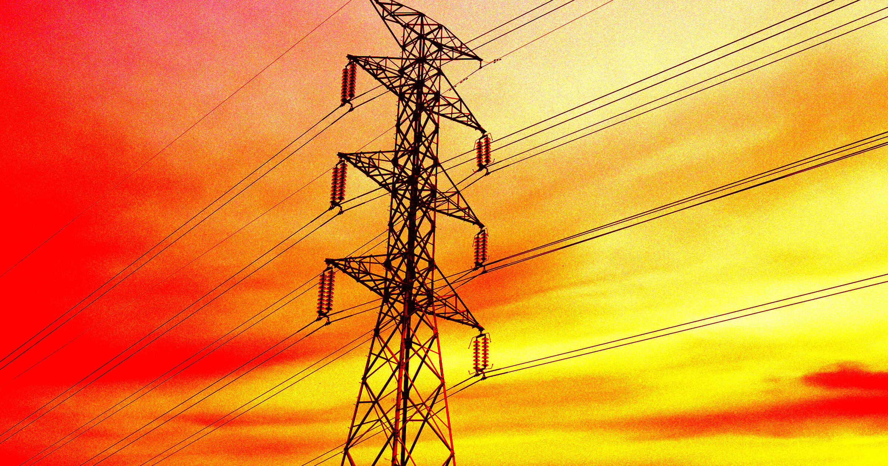

# AI代理耗电惊人，一次查询顶一台冰箱

> 气候学家自测发现，他用 AI 编码助手的一次典型会话，日耗电高达 1.2 至 5.9 千瓦时，比两台冰箱连开一整天还费电。

AI 代理正把每一次查询的用电成本推向新的量级——远超一台普通冰箱的日常消耗。

## 一次会话，顶两台冰箱跑一天

过去人们关心的是单个聊天机器人提示词会烧多少电。如今 AI 代理要复杂得多：它不只是一个大语言模型，而是由模型外加一整套工具和应用层拼成的系统，专门被设计来自主完成复杂任务，功耗远非当年那个朴素聊天机器人可比。这也意味着，想算出它们整体的用电量，难度成倍上升。

偏偏各大私有 AI 实验室对内部能耗几乎集体沉默，外界根本没法断定这些 AI 助手到底给电网添了多少负担。

在一篇被《连线》记者 Molly Taft 注意到的博客文章里，气候学家 Zeke Hausfather 亲自下场，测算了自己平时使用 Anthropic 的 AI 编码助手 Claude Code 时背后那笔隐形电费。结果相当扎眼：他每天平均消耗约 1.2 到 5.9 千瓦时电——对单个用户而言堪称惊人，比两台冰箱连开一整天还要费电。

## 96% 的电，都花在助手读自己的记忆上

大部分电其实没花在生成答案上。Hausfather 统计，他在八周内消耗了约 32 亿个 token，其中绝大多数来自 AI 代理"反复重读自己的工作记忆"——每次工具迈出新的一步，模型都要把累积下来的全部上下文重新过一遍。

"代理每走一步（比如执行命令、读取文件、调用工具），模型就要把此前累积的全部上下文重新处理一遍。"这位气候学家写道。"我真正看到的文字（也就是模型的输出）只占全部处理 token 的约 0.4%。大约 96% 的 token 都是缓存读取，是代理在这 14000 步里反复读自己上下文的花销。这对能耗测算影响巨大，因为读一次缓存 token，比重新处理一个新鲜 token 便宜得多。"

把这样的消耗外推到一整年，Hausfather 估计自己一年的碳排放"比开电热烘干机略多一点，约等于在加州开着电动车跑 11500 英里的一半"。

这个数字单看似乎不算什么，但放到全体 AI 用户身上，立刻就被放大。Hausfather 强调，这"代表着一股净新增的排放来源，而当下全球气温正在飙升，减排目标越来越脱轨"。

## 账还没算完，真正的账单在路上

不过，确切的碳代价至今仍是一团迷雾。据《连线》报道，AI 可持续研究员 Boris Gamazaychikov 把这份测算称为"不错的尝试"，但根基是过时数据。他自己的 AI 代理能耗研究预计 9 月下旬出炉——一旦公布，很可能彻底改写我们对 AI 代理真实成本的认知。而那些藏在每一次查询里的隐形电流，才刚刚开始响动人算总账的倒计时。