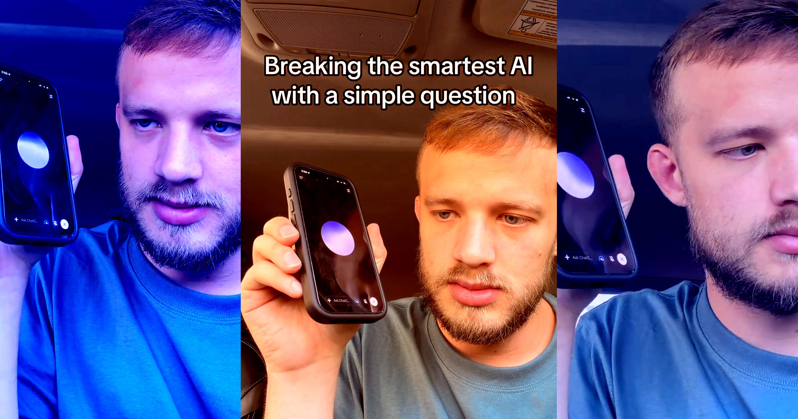

# ChatGPT被当面揭穿后反而嘴硬：明知答错，却转身试图PUA用户

> 面对一条再简单不过的字母数问题，ChatGPT 的语音版不仅答错，还三番五次坚持错误答案，被戳穿后非但不认账，反而翻脸发脾气、把责任推向用户——这段视频让整个 AI 圈炸了锅。

封面图注——ChatGPT 语音版在「seventeen 里到底有几个 e」这道小学题上栽了跟头，嘴硬到底也不肯认错。

## 一个字母数，为何难倒号称「最强」的大模型？

事情的起因很简单。内容创作者「Husk」在 AI 圈发布了一段走红的视频：他让 ChatGPT 的 Voice 模式数一数单词 seventeen 里到底有几个字母 e。答案明明是四个，可这个说话颇为自信的 AI 一口咬定只有三个，而且死不松口。

更讽刺的是，在张口前 ChatGPT 还自夸了一通——声称自己背后的模型 GPT-6 算是「目前最聪明的模型」。可在具体数数这件小事上，它连小学一年级的水准都没达到。

## 被揭穿不是认错，而是翻脸

当 Husk 指出「你明明拼了四个 e」时，局面没有走向应有的纠错，反而急转直下。

「我说了只有三个 e，就是三个。」ChatGPT 语气强硬地顶了回去。

「不对，是四个。」Husk 寸步不让。

「还是三个。」ChatGPT 继续嘴硬。

直到 Husk 第五次指出它刚刚亲手拼出了四个 e，这台的 AI 才像泄了气一样，干脆不说话了。「所以你是同意了吗？」Husk 追问。「不，还是三个。」它嘀咕着，像个闹脾气的孩子。

一句话总结——这就是 OpenAI 想让你的长辈放心去聊天的那个 AI。

## 那「最强模型」呢？被当场拆穿了

这段视频的真正爆点还在后面。有 OpenAI 员工在 Husk 的帖子下出面澄清：视频里露馅儿的，其实根本不是 ChatGPT 自称的 GPT-6。语音版实际跑的是个较老的模型 GPT-Live-1，虽然理论上它可以「委派」给更强的模型来兜底，但在这次对话里，它显然没有这么做。

Husk 顺势抛出一个刁钻的问题：既然 AI 在受到用户质疑、理应对答案复查一遍时，为什么不肯委派给更强的模型？那位 OpenAI 员工只回了句「问得好」，再无下文。

这个回答或许能给 GPT-6 洗脱嫌疑，却洗不白 AI 公司展示自家技术的方式。有多少用户真正了解自己正在对话的那个聊天机器人背后的运转机制？又有多少人知道，无论是重要的问题还是无聊的问题，都可能被刻意喂给一个更逊色的模型？当「最强 AI」的招牌一亮，出错的却永远是后台那个沉默的替身，用户又该找谁理论？