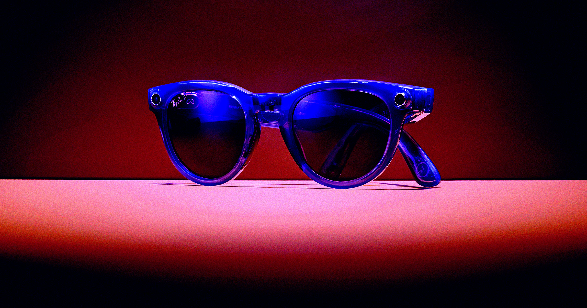

# 「变态眼镜」被骂到不敢戴，Meta 被曝转做无摄像头版本

> 曾被吹成爆款的 Meta 智能眼镜因沦为偷拍骚扰的工具而口碑崩盘，如今公司被曝正在研发一款连摄像头都没有的新眼镜，代号 Luna。

被骂作「变态眼镜」的 Meta 智能眼镜，正从热销产品变成公司难堪的公关包袱。

## 从爆款到人人喊打

在创纪录的短时间内，Meta 那副带摄像头的智能眼镜就从一款利润丰厚、评价不错的消费产品，变成了广受唾弃、侵犯隐私、被猥琐男拿来作恶的工具。

反弹之大，已让不少「变态眼镜」的主人都害怕在公共场合佩戴。对一款曾卖到脱销的产品来说，这是彻头彻尾的公关灾难。Meta 显然被愈演愈烈的批评惊到，正拼命想办法加装「急杀开关」，并远程把一些「manfluencer」（疑似骚扰女性的网红）的眼镜变砖。

## 干脆把摄像头砍掉

据 The Information 报道，这家由 Mark Zuckerberg 掌舵的公司还打算在今年晚些时候推出一款没有摄像头的版本——这是迄今最能说明 Meta 在舆论法庭上正在败诉的信号。

去掉摄像头能否平息外界对隐私的担忧，还很难说。这款无摄像头眼镜代号 Luna，仍将配备由六个麦克风组成的阵列，用来和公司的 AI 聊天机器人以及新近发布的 AI 助手 Muse 对话。这些麦克风大概率也会收录用户周围环境的声音，而身旁的路人未必意识到自己被听了去。

## 一纸集体诉讼

就在消息传出的几天前，两个家庭提起了集体诉讼，指控 Meta 从用户的 Instagram 和 Facebook 照片中提取生物特征信息，用来为其智能眼镜搭建人脸识别系统。

## 一场关于「为什么买它」的测试

这副眼镜或许会成为终极试金石，检验当初究竟是什么吸引了人们掏钱。只靠麦克风，Meta 等于在赌人们愿意花上几百美元，只为和它那个漏洞百出的 AI 伙伴说说话——而不是拍第一人称视角的照片。

代号 Luna 的项目最快可能在下周的 Meta Connect 大会上亮相。公司将如何回应外界对摄像版智能眼镜的猛烈批评，如果它打算回应的话，值得一看。要它公开承认自家消费产品在公共场合助长了极其令人不适的行为，恐怕不太可能——但那头大象注定要留在房间里。
