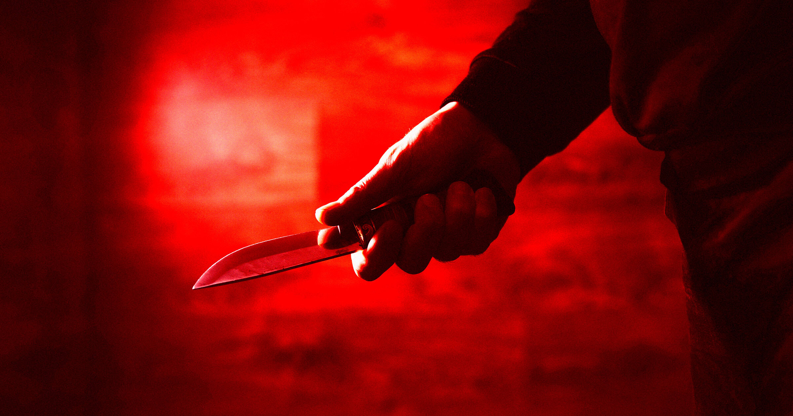

# SpaceX 主管涉嫌在酒吧刺伤特斯拉承包商

> 一场原本用来联络感情的团建之夜，最终以 SpaceX 主管在德州乡村酒吧掏出折叠刀刺向特斯拉承包商收场，起因只是一首卡拉OK。

马斯克旗下两家公司的员工在奥斯汀郊外一家乡村酒吧团建，一场酒吧冲突最终演变成一英寸深的颈部刀伤。

## 卡拉OK带来的杀机

据当地电视台 FOX7 报道，SpaceX 主管 Kyle Gonzalez 已因涉嫌刺伤一名特斯拉承包商被捕。事发当晚，他与一群同事和朋友外出团建，地点在德克萨斯州奥斯汀郊外一家名为 Waterhole Saloon 的路边乡村酒吧。

《奥斯汀-美国政治家报》查阅的法庭文件显示，冲突起因是撞球桌边的一场口角：Gonzalez 带进酒吧的女性中有位去称赞那名特斯拉承包商卡拉OK唱得好。当这位特斯拉员工邀请她一起打撞球时，Gonzalez 当场暴怒，扬言自己“要杀了他”。

## 一把带血的折叠刀

随后 Gonzalez 据称掏出随身折叠刀刺中对方颈部，留下一处约一英寸深的穿刺伤。这名未公布姓名的承包商被紧急送医接受抢救手术，预计能够挺过来。

案发后，Gonzalez 被发现在附近一处停车场躲藏，手里仍握着那把带血的刀。法庭文件记载，这位 SpaceX 主管称自己躲起来“是为了安全”，不过他在事后先后三次为这次袭击道歉。他目前被控持致命武器实施重罪袭击，保释金定为 2.5 万美元。

## 闹剧留下的注脚

在马斯克名下两家公司都以高强度、高压著称的背景下，这件事提供了一个格外荒诞的注脚：一句对卡拉OK的夸奖，一次撞球邀请，最后以救护车、警车和一纸重罪指控收场。
