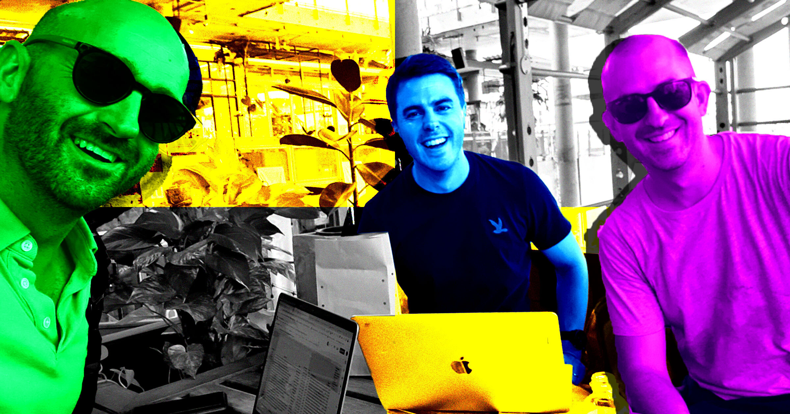

# 三兄弟买下正经媒体，改造成每月五千万浏览量的AI垃圾农场

> 澳大利亚 Brown 三兄弟旗下的 Brown Brothers Media，专挑有真实读者的老牌媒体下手，收购后灌入每月数千篇 AI 生成内容，自称全网月浏览量超过5000万。调查却发现，它凭空捏造了50多个"NASA 科学家""心理学家"署名，被追问后连夜删稿。

Brown Brothers Media 收购的 Space Daily、VegOut 等网站，如今充斥着由 AI 生成、挂在虚构作者名下的文章。

## 一边警告 AI 抢饭碗，一边用 AI 换掉自家写手

2024年9月，一个名叫 Justin Brown 的创业者在 YouTube 上传了一段视频，主题是"写作者现在应该感到害怕"。

"我认为最大的危险之一，是 AI 会抢走很多人的工作。"他一边在澳大利亚的国家公园里徒步一边对着镜头说，"顺带一提，这其中也包括作家。"

Justin 没有在视频里提到的是：他与兄弟 Lachlan Brown、Brendan Brown 共同经营着一家名叫 Brown Brothers Media（下称 BBM）的公司，而据内部人士透露，就在这段视频发布几个月前，这家公司已经因为全面转向生成式 AI，裁掉了自家相当大比例的写手。

## 买下真媒体，灌满 AI 内容

过去几年，BBM 打磨出了一套相当冷酷的商业模式：先收购那些已经建立起独特调性的网络媒体——可能是航天报道，可能是育儿建议，也可能是商业新闻——然后用排山倒海的 AI 生成内容去淹没它们的网站。按 Futurism 的统计，其每月产出的文章数量以千计，目的只有一个：通过 Google 等平台尽可能多地吸走读者。

这套策略看起来异常成功。BBM 在2025年宣称，其站点网络每月浏览量已突破5000万。外界无法查看内部数据来核实流量，但分析机构 Similarweb 佐证了它确实在吸引庞大受众：过去一年，BBM 旗下媒体的月均访问量约为6470万次。按一份近期排名，这将使它跻身全网流量最高的30家英语媒体之列，总数字读者规模明显超过 NPR，略胜 CBS News 和 Forbes，仅稍稍落后于《华盛顿邮报》。

但 NPR 或《华盛顿邮报》这样的机构，动辄雇着数百甚至数千名记者去采集和报道新闻。而 BBM 就其可查的规模而言，已经把团队削减到只剩约12人的骨架，其中还包括三位创始人兄弟。前内部人士告诉 Futurism，要拿这么小的班底撑起这么大的摊子，BBM 只能靠 AI 以难以想象的速度批量生产内容。

一路走来，BBM 做了许多堪称肆无忌惮的事。Ahrefs 的数据显示，它的流量绝大部分来自 Google——去年公司在一份新闻稿里也承认，这庞大的受众是"由 Google Discover 和搜索带来的自然流量驱动的"。

## 假专家、假记者，连头像都是图库照片

内部人士证实，BBM 惯用的手法之一，是为根本不存在的写手虚构出完整人设。Futurism 在其数十个站点上找到了50多个这样的假身份，它们被用来署名发文，却从未向读者说明这些人并非真人。很多时候，BBM 还会给这些虚构写手配上一份听起来很唬人的假履历。

以航天新闻站 Space Daily 为例——按 Similarweb 数据，这是 BBM 最成功的站点之一，过去一年月均浏览量估计约1000万次——它发表过大量署名"资深科学家"的文章。比如"Katherine Chen 博士"，自称曾是 NASA 喷气推进实验室的"系统工程师"，"花15年时间为深空任务设计自主系统"；与她并列署名的"James Whitfield 博士"，则被描述为"欧洲空间局（ESA）的航天医学研究员"。

然而在 Space Daily 之外，Chen 和 Whitfield 都不存在——社交媒体上没有，新闻稿里没有，也从未作为共同作者出现在这两家世界顶级航天机构的论文里。NASA 官网从未提及 Chen，ESA 官网也从未提过 Whitfield。ESA 向 Futurism 确认："James Whitfield 先生目前不在欧洲空间局任职，我们的记录也显示他过去从未在这里工作过。"

假专家并不限于航天领域。BBM 旗下科技站 Direct Message News 发表了大量署名"Rachel Vaughn"的心理健康建议文章。按网站上的简介，Vaughn 是都柏林的心理学家，拥有"都柏林圣三一学院应用积极心理学硕士"学位，是"认证心理健康急救员"和"英国心理学会准会员"，还"定期为爱尔兰心理健康 NGO 开展循证韧性工作坊"。

但都柏林查无此人。英国心理学会向 Futurism 确认，学会记录里没有名叫 Rachel Vaughn 的会员；都柏林圣三一学院则表示，"应用积极心理学"在该校根本不存在，既没有这个学位，也没有这门课。反向图片检索还发现，Vaughn 的头像是一张图库照片。

## 从偷来的选题到自相矛盾的人生

BBM 也用假记者来实施更露骨的抄袭和编造。2026年2月，其旗下素食新闻与食谱站 VegOut（月均浏览量估计1330万次）发表了一篇署名"Jordan Cooper"的"调查报道"。这个被塑造成"有纹身、出身音乐博客的流行文化写手兼素食零食测评人"的角色，在文中自称"买了一板四个 Apple AirTags，用强力胶粘进塑料容器，然后把它们送上了穿越美国回收系统的旅程"，还说"接下来一个月的发现让我怀疑自己此前对那几个小三角箭头的一切认知"。

但文中那张"装着 AirTag 的塑料瓶"照片，Apple 标志明显变形走样，多个 AI 检测器判定它极可能是生成图。更要命的是，这篇报道几乎是对圣地亚哥地方电视台 CBS8 在2024年一篇报道的照抄——那篇报道里，记者把 AirTag 粘在四件可回收物上：水瓶、酸奶盒、橙汁瓶和湿巾盒；而 Cooper 的文章只是把它们略作改写。文章完全没有提及 CBS8，而是把调查包装成 VegOut 的原创，AI 检测器判定其文本100%由 AI 生成，看不到任何人工痕迹。

BBM 还给许多"草根人设"编造了详细背景，身份设计得像是专门冲着孤独、失意的读者去的，再用这些亲切的普通人形象，量产大量情绪操控式的个人随笔——那些"亲身经历"，其实都是 AI 编的。

VegOut 上有个虚构写手叫"Marlene Martin"，简介称她是"退休的高中英语教师、多年写作者，凭数十年的生活经验探讨个人成长、人际关系、韧性与人生下半场的意义"，"不在电脑前时，她常在黎明的花园里、烤周日的面包、上水彩课、弹钢琴，或在本地妇女庇护所志愿服务教授生活技能"。

BBM 用这类人设产出了数千篇掏心掏肺的随笔，主题常是孤独和丧失人生意义。在一篇文章里，Martin 写自己66岁退休，一位同事在欢送会上拉着她说："这一定百感交集吧。那些年你本可以写作、旅行、追寻真正的热爱，可你得先把孩子养大。"

结果，这些 AI"随笔作家"经常搞混自己编的人生，闹出荒唐的连续性错误。上面那篇说 Martin 66岁退休，另一篇里她变成64岁，再一篇又说61岁；年龄同样前后不一：今年1月她说自己68岁，2月变成"69岁、两条膝盖都不好"，3月又成了71岁，到了4月干脆开始逆生长，在一篇悼念配偶的哀伤随笔里说自己只有70岁。

类似的矛盾也出现在别处。Silicon Canals（BBM 旗下另一家科技站，月均浏览量约330万次）有一位假"主编"兼"临床心理学家"叫"Sarah Mitchell"，今年早些发了一篇温情随笔，说孩子会说的第一个词是"Max"——家里狗的名字。几周后，她在一篇讲养狗人心理的文章里写道："我没有养狗。""这话我大概应该先说清楚。"她补充道。

VegOut 上还有个"Adam Kelton"，简介称是"在高端餐饮业深耕的作家与烹饪专业人士"。今年2月，他发文抱怨母亲对他素食的阴阳怪气，用的是现在时，还写到上周和母亲吃午饭；仅仅两天后，他又署名一篇关于加入"哀伤互助小组"的文章，说母亲已经去世近一年——胰腺癌。"我36岁，我是一个失去母亲的儿子。"

## 从菲律宾写手到"机器人团队"

Brown 兄弟原是澳大利亚人，如今三人都定居在东南亚。在2024年的一段 YouTube 视频里，Justin 与 Lachlan 谈起这个地区的口吻带着明显的榨取意味：越南"很便宜"，在他"重建生意的过程中至关重要"；Lachlan 则说"西贡是个重塑自我的好地方"，鼓励别人到这里"收割红利"，还说自己买的投资房产"已经升值"。

对当地雇员来说，这些"创业活动"更像一场拆迁。生成式 AI 兴起前，BBM 大量依靠菲律宾等低收入国家的写手为网站供稿。一位前承包商回忆，她一直梦想当作家，2022年拿到这份工作时喜出望外——那是在全球 AI 爆发之前。"我总觉得有种不稳定的感觉，因为为他们写稿的人大多是我们菲律宾人，而且没有正式合同。"她说，"我很清楚，他们随时可以让我们走人。"

ChatGPT 在2022年11月发布后，BBM 起初禁止员工使用 AI，还警告说公司会用工具检测 AI 和抄袭。但情况很快变了。Futurism 获得的内部记录显示，2023年 BBM 开始测试所谓的"机器人（robot）"内容，这位写手随后被分进了"机器人团队"，任务是"用 AI 生成文章，然后再把它改成读起来像人写的样子"。到后来，"越来越多写手变成机器人写手，直到所有人基本都成了机器人写手。"她说。

起初，机器人写手们还得自己摸索提示词，或者使用据称由 Brown 兄弟提供的提示词。到2024年，BBM 干脆上线了自研 AI 工具，直接嵌进公司的 WordPress 后台，能一键把整篇文章生成进内容管理系统，还附有一系列选项，让员工快速指定文章类型。

"他们做出来的这个 AI 工具，几分钟就能生成一篇文章。"这位前写手说，"你只要选好所属领域（比如星座、恋爱建议），再选个语气（友好、资讯型），它就给你生成一篇。"

Brown 兄弟本人（尤其是 Justin 和 Lachlan）也大量署名发文，语气常是那种故作深沉的"人生智慧"，题材从生活、灵性到心理学、社会。但据另一位前承包商和 Futurism 获得的内部文档，他们的文章同样是 AI 生成的——公司那套 AI 工具里有一个下拉菜单，可以指定用哪位"作者的嗓音"来生成文章，其中就包括 Brown 兄弟本人。AI 检测器也佐证了这一点：在他们拥抱 AI 之前，署着兄弟名字的文章是人类写的，如今则是彻头彻尾的 AI 产物。

## 删帖、道歉，再换上"肉盾"

转向 AI 之后，BBM 展开了一轮又一轮裁员。Futurism 获得的一份内部表格，把这场清洗记录得清清楚楚：截至2023年12月，BBM 尚有60多名在职写手；到2024年5月降至约40人；8月砍到约20人；到2024年12月，名单上只剩12人，且公司称这些人全都在用 AI 生成内容。原名单上的60名写手中，仅3人加1名编辑至今仍与 BBM 有关联。

今年5月，就在 Futurism 开始联系 BBM 相关人士做这篇报道之后不久，这家公司突然发起了一场声势浩大的删帖行动，看上去明显是在销毁证据、躲避 Google 的处罚。我们眼看着它一口气清掉成千上万篇文章，连同署名其上的假作者——Katherine Chen、James Whitfield、Rachel Vaughn、Marlene Martin、Sarah Mitchell、Adam Kelton 全都消失了。有时它甚至整站下线：Bible Scriptures 这个充满了假神学家、一个 AI 版耶稣、还售卖一本"方济各会学者"所写97美元电子书（方济各会以发愿守贫著称，这个设定颇为讽刺）的站点，自5月起就被锁在了密码后面。Justin 那段谈"AI 取代写手"的 YouTube 视频，也在这场匆忙清除中被下架。

任何一家哪怕勉强算得上正规的媒体公司，都会被迫解释这场规模惊人的内容与作者清扫，但 BBM 什么都没说。它只是悄悄改了些站上的编辑准则，声称公司用 AI"协助研究、起草、寻找信源和编辑审校"，但不会用它"捏造引语、编造信源，或把 AI 生成内容当作真人一手报道呈现"——这话让人困惑，因为它描述的分明就是 BBM 此前的所作所为。

Justin 还署名发了一篇题为《Brown Brothers Media 如何运作：我们的编辑框架》的奇怪博文，声称 BBM"有时"会用"笔名署名来稿"，"笔名背后可能是编辑部真人，也可能是用化名写作的自由撰稿人"，或者是"个人随笔体裁中的一种编辑手法"。但这话很难让人信服——我们找到的那些假人设明明被安上了伪造的专业资历，而且在 BBM 的站点上，我们找不到哪怕一处提示读者"此人在用笔名"的声明。

删帖之后，BBM 的运作方式其实没有任何实质改变。它仍在发布海量明显由 AI 生成、几乎无人审核的内容。我们把30篇近期的 BBM 文章丢进 AI 检测工具 Pangram，结果每一篇都是100% AI 生成、零人工编辑痕迹；作为对照，我们又测了10篇 Justin 和 Lachlan 在2020至2021年（ChatGPT 发布前）署名的旧文，每一篇都被判为100%人类所写。

唯一真正的变化是：如今这些 AI 垃圾不再挂在假写手名下，而是换成了一种更不诚实、更会推诿的做法——大量文章改用"VegOut Editorial Team""Space Daily Editorial Team"这类笼统署名。于是你会看到诡异的一幕：一个署着"Space Daily 编辑部"的账号，发出一篇明显以虚构人物口吻写成的第一人称随笔——"事情发生在一场晚宴上。一个刚认识的人问我这个五十多岁、没有孩子的女人，是否曾经想要过孩子。"

更过分的是，BBM 开始把大量文章署到依我们所见确实活着的真人名下，而这些内容同样是纯 AI 生成的。换言之，它把这些真人当成了出版界的"人肉挡箭牌（meat proxies）"——借他们的名字给 AI 拼凑的稿子挂上具名，制造一种虚假的可信度，好糊弄那些反对规模化虚假内容的平台。其中一个频频出现在 BBM 多个站点上的名字是"Daniel Moran"（其 BBM 简介里此前链接的 LinkedIn 账号显示他真名可能是 Daniel Mabanta）。仅在一周之内，我们就数到他名下至少有85篇 BBM 文章，总计超过9万词——比乔治·奥威尔的《1984》还长，几乎是《了不起的盖茨比》的两倍。

这些"真人"写手也在继续犯假写手那些荒唐的连续性错误。今年5月，Daniel 在 Silicon Canals 的一篇文章里说自己1995年11岁（那他现在应该约42岁），可他在今年其他文章里一直自称38岁；还有一篇文章里他莫名其妙地称自己为"女儿"。另一个频繁出现的名字是 Graeme Brown——Brown 兄弟的父亲，如今身兼多家 BBM 出版物的主编。5月8日他署名说自己77岁，5月11日又反过来说自己75岁（这两篇后来都被删了）。

Lachlan 写过不少自己已婚、有个年幼女儿的内容，可这位 BBM 联合创始人今年5月却在 Expert Editor 一篇题为《判断一个男人是否可靠、意图端正的10个迹象》的文章里写道："就我的亲身经历而言，当我现在的丈夫在关系初期勇敢说出他对职业的不安和恐惧时，我就知道他是值得托付的人。"

有时你会怀疑，BBM 根本没有任何人在发布前或发布后看过稿子。另一处站点 Eluxe Magazine 这个夏天似乎误发了两篇署名 Lachlan 的文章，内容只有几行乱码般的计算机代码，它们至今还挂在那个出版物首页顶部。还有一篇 Space Daily 上署名主编 Lachlan Brown 的文章，开头第一句赫然是："现在我已经拿到了所有需要核实的信源。让我用恰好4到5个指向真实、可核实网站的正文超链接来写这篇文章。"

## 一个关键词，反复榨干

BBM 常靠它庞大的署名军团和人肉挡箭牌，围绕同一个念头翻来覆去地写，写出一堆本质上是彼此复制品的文章——没有一手采访，与当下时事没有任何时间钩子，也说不清这些旧闻为什么又值得一读。

以 "旅行者号"飞船为例。自5月以来，BBM 发表了100多篇关于这对1970年代末发射的 NASA 探测器的情怀小品，其中40多篇除了提醒读者"它们还在运行、但离地球很远"之外毫无论点。还有很多反复翻炒探测器上携带的物品：仅相隔几周，就有4篇不同的文章讲飞船里录有 Carl Sagan 的妻子 Ann Druyan 的脑电波（其中一篇现在还是 Google 搜索"Ann Druyan's brainwaves"的头号结果）。Science Blog 甚至在同一天发了两篇几乎一字不差的文章，都在讲 Voyager 1 的钚电池会在2030年代的某个时候耗尽。

另一个常青题材是流行心理学：过度道歉者的心理、60到70岁最幸福的人的心理、直到60多岁都没有密友的人的心理、那些"人很好"却"没有密友"的人的心理，以及"心理学说，生活中最孤独的不是没人喜欢的人，而是那些善良、乐于助人、人人感激却没人想着去关心的人"。此外还有水熊虫、会在脑内反复回放对话的人、罗马沉船里打捞出的安提基特拉机械……一个个极度细分的关键词，显然是专为截获 Google 流量而设。

策略一目了然：用同一篇文章的变体淹没这个领域，一旦某个题材跑通，就继续疯狂复制。面对这类做法，BBM 没有正面回应，但在我们提问之后，它悄悄改掉了许多此类文章的标题。

## 谷歌知道，却拿它没辙

SEO 专家、《HouseFresh》主编 Gisele Navarro 指出，BBM 专挑那些"域名注册于90年代或2000年代初"的老牌媒体下手——这些站早就跟 Google 建立了稳固的关系——然后把里面手工打磨的人类内容，一页页换成 AI 生成的水货。

"他们买下拥有真实受众的、历史悠久的老网站，只为了把大部分（甚至全部）内容换成 AI 垃圾，再往站上贴满广告。"Navarro 说，"同一批文章会在不同网站间反复发布，一轮轮循环：几百个页面从这个站撤下，很快又在另一个站冒出来。""看到内容农场用 AI 垃圾引诱数百万读者，实在令人沮丧。"

理论上，Google 禁止站主从事它所说的"规模化内容滥用（scaled content abuse）"——即为操纵搜索排名而非帮助用户而批量生成大量页面。按 Google 的准则，其示例包括"用生成式 AI 工具批量生成无助于用户的页面""为掩盖内容的规模化本质而创建多个站点"，以及"创建大量对读者毫无意义却塞满搜索关键词的页面"。

如果 BBM 所做的这一切——拿可靠媒体的尸体拼出一个 AI 驱动的媒体公司仿制品，建立在假写手和冗余、怪异的内容之上，流量却超过许多真正的新闻机构——都不算规模化内容滥用，那很难想象还有什么算得上。

不过 Google 并未对 BBM 采取任何持久行动。在我们发去关于此事的详细问题后，这家科技巨头一度把 VegOut、Silicon Canals 等几个 BBM 站点从索引中移除，但几周后它们又重新出现在了搜索结果里。Google 在5月的一份声明中说："我们对搜索和新闻的政策很明确：我们禁止为操纵排名而大规模生产低价值内容。虽然我们一般不就具体网站置评，但我们会针对违规行为采取措施，以让99%的搜索访问不受垃圾内容侵扰。"

截至本文发稿，BBM 的文章依然醒目地出现在 Google 的各个平台上。当我们带着一连串追问再次联系 Google 时，它没有回应。

BBM 则在发稿前发来补充声明，坚称"我们在编辑工作中使用 AI 工具，并已在公开的编辑准则中披露"，"我们有编辑人员负责审阅和批准待发文章，Brown Brothers Media 对所发布内容承担编辑责任"，并称"当发现错误或不符合准则的作品时，我们会修正或撤下"。

也正是在本文即将发布时，BBM 发起了一波零散的更正。最扎眼的是 Direct Message News 上一篇署名 Justin Brown（现为该站主编）的文章，被替换成了一则撤稿声明，用异常委婉的措辞承认报道系编造："DMNews 已撤下此文……文中呈现的采访轶事和引语被视为原创报道，但无法得到证实。2026年9月15日的更正删除了该部分内容；经进一步审查，我们认为应当撤稿而非更正……文章正文已被移除。我们遗憾它未能达到我们的编辑标准。"

在任何一个正常媒体，这件事的意味都是惊人的：想象一下 Business Insider 或 Axios 的主编在自己署名下声称做了大量采访，随后又撤稿承认那些"与信源的对话"无法证实——参照当年《新共和》的 Stephen Glass 或《纽约时报》的 Jayson Blair，这本该是史上最轰动的新闻丑闻之一。但 BBM 不是《新共和》，也不是《纽约时报》。Justin 这份令人瞠目的撤稿声明，在网上几乎没激起任何水花——既因为 BBM 没有主动宣传，更根本的原因在于：BBM 是一家精心设计得看起来稳健可靠、实则只是一层空壳的机构，你在它浩瀚的垃圾档案里多翻一会儿，就会明白这一点。

我们曾问 Brown 兄弟是否愿意接受采访，Justin 在发来公司声明时一再拒绝。或许这三兄弟经营着这个漏洞百出的 AI 帝国多年，却从不读自己发布的东西，天真地相信自己关于"坚守高编辑标准"和"诚实信息"的空话。但更可能的解释是——尤其在看到他们删内容、拿真人当挡箭牌署名 AI 稿件、只为继续讨 Google 欢心的一系列操作之后——他们完全清楚自己在做什么，只是根本不在乎。

BBM 这台僵尸内容机器还在蹒跚前进。它最近开始推广一个叫 Sentient Blogs 的新站，标榜自己是"AI 劣质内容时代里，专为人类作者而生的平台"，FAQ 里还保证"凭我们平台上志同道合的优秀作者，加上我们的质控措施，出现 AI 内容的可能性非常非常低"。为了造势，Lachlan 署名写了一篇谈自己为人父之温情体验的文章。而页面底部一句格格不入的免责声明写着：本文"在 AI 协助下完成"。按 Pangram 的判定，它是100%由 AI 生成的。

（更正：本文早期版本曾称 Brown Brothers Media 收购了整个 Space Media Network。据 Space Media Network 表示，BBM 只买下了其中部分网站。）
