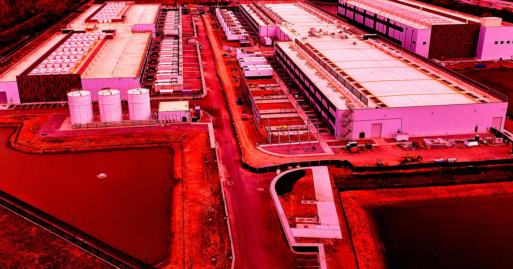

# 伊朗无人机袭击亚马逊数据中心，客户数据被永久抹除

> 伊朗无人机连续数月轰炸亚马逊在阿联酋和巴林的数据中心，AWS 已承认部分服务器上托管的资源与数据"无法恢复"，客户数据被永久删除。

亚马逊位于中东的数据中心在伊朗无人机打击下损毁，客户数据出现不可逆的丢失。

## 数据不是断了，而是再也回不来

据亚马逊云服务（AWS）9月15日发布的最新通报，伊朗无人机此前的袭击已让该公司位于阿联酋和巴林的多座数据中心严重损毁。亚马逊首次承认，它"无法恢复"这些本地数据中心上托管的资源与数据——对云服务商而言，这句话意味着部分客户数据被永久删除，而不只是临时中断。

亚马逊在通报中写道："我方基础设施的损坏横跨多个可用区（Availability Zone），超出了我们的区域级与多可用区服务的设计承受能力。"可用区是同区域内一座或多座数据中心的集群，通常被用来做冗余备份；一旦受损范围跨越多个可用区，本应互为保险的备份也一起失效了。

## 从三月开始的连环打击

袭击并非一次性的。亚马逊指出，无人机打击最早从今年3月就已开始，那时阿联酋和巴林的数据中心便遭到"结构性损坏、供电中断，有些情况还需启动灭火系统，进而造成额外的水浸损失"。AWS 随即要求客户把数据迁往其他云区域，并尽量利用异地备份。到4月，伊朗无人机再次打击亚马逊位于巴林的数据中心，造成一次严重的"服务中断"。

## 中东AI基建撞上地缘政治

伊朗显然打中了要害。眼下 AI 行业正把巨额资金投向中东，扩建支撑 AI 的数据中心，而特朗普政府对伊朗开战带来的地缘政治动荡，可能成为这些业务最现实的绊脚石。就在上周，阿联酋官员宣布，在最新一轮袭击后正修改其 AI 数据中心规划——这进一步凸显出伊朗以相对低成本就能利用的那处要害。

当一座数据中心既是商业资产、又被视为合法军事目标，服务器机柜上的指示灯熄灭之后，消失的不只是算力，还有可能再也找不回来的数据。
