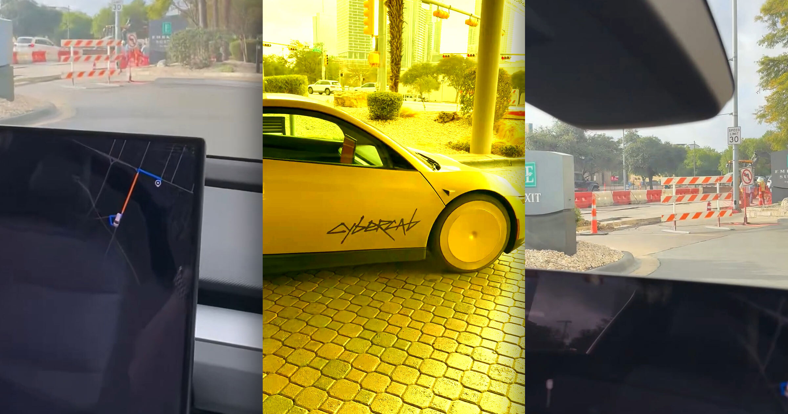

# 特斯拉 Cybercab 首秀翻车：困在酒店停车场，把乘客原路送回

> 一名乘客在奥斯汀叫来特斯拉 Cybercab，结果这台没有方向盘的黄金出租车连酒店停车场都开不出去，来回折腾四趟后宣布"您已抵达"——终点就是起点。

特斯拉 Cybercab 在奥斯汀投入运营不久，就接连闹出令人哭笑不得的接送事故。

## 黄金出租车开不出停车场

在得克萨斯州奥斯汀，一名男子原本想体面地坐车离开酒店，结果这趟行程还没驶出建筑就宣告失败。他的座驾是一台特斯拉 Cybercab——马斯克旗下那款没有方向盘、也没有踏板的自动驾驶出租车。

这名自称计算机工程师的乘客在 X 上贴出了简短视频："Robotaxi 到了……然后就开不出酒店停车场。"他随后解释，当时施工人员封掉了一条车道，而这台金光闪闪、算力惊人的 Cybercab，偏偏就是"看不见"旁边那条仍然畅通的车道。

他没到目的地，但确实"到达"了某个地方。按他的描述，这台车"来回开了四趟，然后停下来说我已经到了"。他的结论很直白："第一次体验相当糟糕。这项技术显然离大规模落地还差得远。"

## 离谱的落客点早就不是新闻

Cybercab 本月才在奥斯汀投入运营，此前外界已经等了好几年。特斯拉用改装版 Model Y 在该市跑了一年多的 Robotaxi 服务，而 Cybercab 是它第一款专门为此设计的车型——取消方向盘和踏板，等于宣告在人驾驶这件事上不留退路。不过目前许多 Robotaxi 车内仍然坐着真人安全员，公司对此显然心里有数。

这次亮相并没有达到特斯拉的期待，不少投资者对 Cybercab 的发布反应冷淡。这些金色车暂时没卷入高调事故，但它的软件能力与行业领头羊 Waymo 相比并不占优。联邦监管机构还在调查特斯拉如何在缺少传统操控装置的前提下，自我认证车辆适合上路。

酒店停车场这出乌龙，只是该公司 Robotaxi 一系列古怪行为的延续。乘客抱怨它们经常在奇怪的位置接人放人，从繁忙十字路口中、隐蔽小巷，到离目的地远得离谱的地方，什么地点都可能出现。

## 粉丝吹捧与现实的距离

特斯拉的支持者仍在努力为这些车造势。就在一台 Cybercab 被困酒店的约一周前，另一个特斯拉相关账号还发视频炫耀 Cybercab 到自己酒店接人的经历："坐进这台车，你会觉得自己像 VIP。"

现实版本是：另一位乘客的 VIP 体验，是从酒店停车场出发，绕了四圈，再回到酒店停车场。
