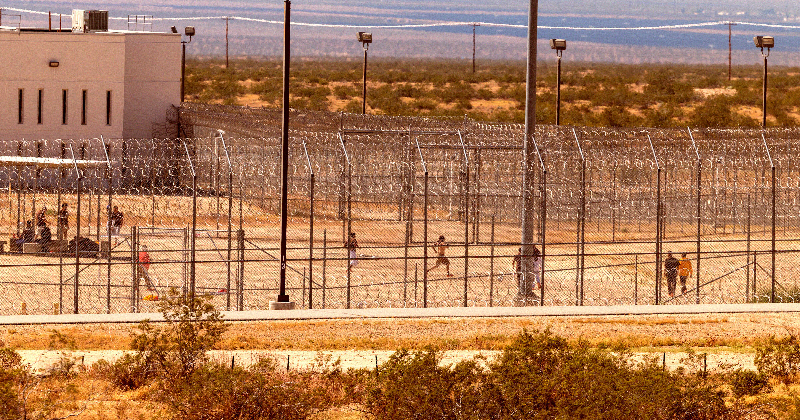

# ICE拘留中心流产多到数不清，孕妇被铐在病床上才知道孩子没了

> 特朗普重返白宫后的前九个月，ICE在其羁押人员中记录了18起孕妇流产；而《卫报》发现，这份流产记录只更新到2025年10月，此后失去的每一个胎儿都被"弄丢"了。

美国移民拘留设施内的孕产妇医疗长期缺位，流产记录在2025年10月之后直接中断。

## 18起流产，然后记录就断了

美国移民和海关执法局（ICE）的拘留设施对任何人都堪称噩梦：居住条件恶劣、处置方式带有折磨性质、基本医疗严重缺位。而偏偏有创纪录数量的孕妇被卷入其中——对处在孕期的人来说，很难想象还有比这里更糟的地方。

《卫报》的最新调查深挖了被ICE羁押的孕妇和未成年女孩所获得的医疗状况。在特朗普重返白宫后的头九个月里，ICE记录了其羁押人员中发生的18起流产——这个数字本身已经足够骇人，而更荒唐的是，记录到2025年10月就停了，此后所有失去的妊娠都不知去向。

对关键健康数据的这种漫不经心，恰恰印证了联邦拘留设施中孕妇所处的恐怖处境。

## Anabell的经历：两根验孕棒，然后就没了

来自尼加拉瓜的寻求庇护者 Anabell 把自己的经历讲给了《卫报》。在一次例行的政府报到结束时，她被当场拘留。Anabell 说，她做过两次验孕测试，结果都是阳性。但到此为止——标准的血液检查没有，产前维生素没有，连配给的蛋白质份量也几乎没变。

被关押一个月后，Anabell 开始出血。"我告诉他们我需要看医生，"她说，但ICE的工作人员无动于衷。又在设施里熬过一天之后，同被羁押的人终于说服警卫把她送到急诊室——在那里，她被铐在病床上，由三名ICE探员看守。

通过翻译，Anabell 得知自己已经流产。此后她持续出现出血、呕吐、皮疹，以及脱发和体重下降等并发症，却再没有得到任何额外治疗。

"我不知道自己会怎么样，"她对《卫报》说。

## "ICE显然知道"

罗伯特和埃塞尔·肯尼迪人权中心的高级律师 Sarah Decker 对《卫报》表示，很难相信ICE真的不清楚自己手上关着多少孕妇，也不清楚她们面对着怎样恶劣的医疗条件。

她说，在路易斯安那州巴塞尔（Basile）的南部处理中心，她们接触到的许多孕妇都表示曾向ICE官员说明自己怀孕，不得不反复争取产检和妇科医生的接诊，还得为并发症乞求紧急救治。

> "ICE显然知道情况。我认为他们想要模糊公众获取这些数据的途径，目的就是掩盖这些设施里正在发生的、危及生命的医疗疏忽。"
> ——Sarah Decker，罗伯特和埃塞尔·肯尼迪人权中心高级律师

一个连自己羁押了多少孕妇、有多少人流产都"数不清"的机构，其数据缺口本身就成了最好的证词。
