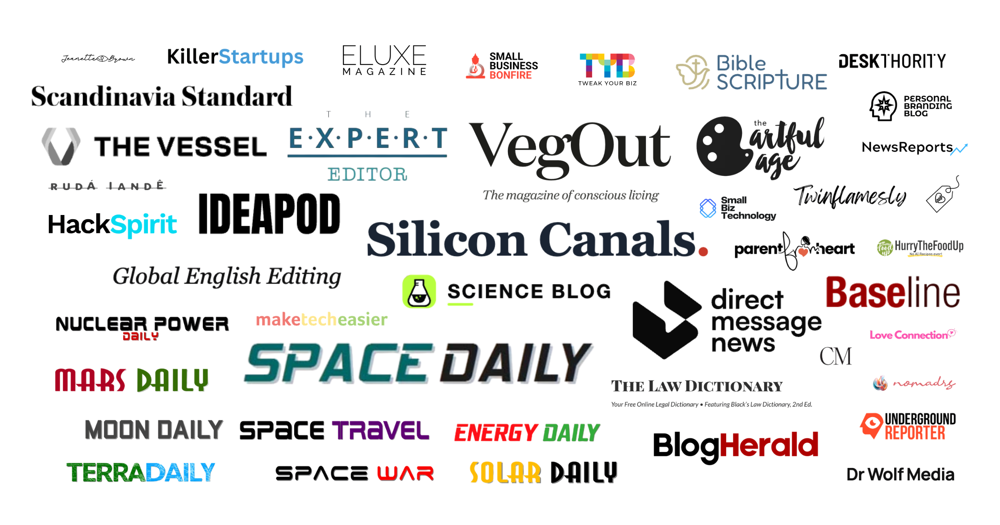

# 专收濒死媒体、用AI批量造假稿：Brown Brothers Media 旗下网站清单曝光

> Futurism 历时数月调查发现，Brown Brothers Media 靠收购经营困难的新闻网站再改造成AI内容工厂，大规模使用虚构作者、批量发布编造的报道和"亲历故事"，如今这份网站清单被摆上了台面。

Brown Brothers Media 把收购来的老牌新闻网站和垂直博客改造成AI稿件流水线。

## 从兄弟三人的个人博客起家

Futurism 刚刚刊登了针对 Brown Brothers Media（简称 BBM）的长期调查。这家公司收购经营困难的新闻出版物，把它们改造成由AI驱动的内容工厂，同时大量使用不存在的"作者"，批量产出编造的报道和第一人称经历。

BBM 创立于2020年代初，当时旗下品牌数量有限，其中有几个就是 Brown 家三兄弟——Justin、Lachlan 和 Brendan——自己创办的：Brendan 的 Global English Editing 和 Expert Editor，Lachlan 的 Hack Spirit，以及 Justin 的 Ideapod。Justin 还和巴西萨满 Rudá Iandé 共同创办了 The Vessel，后者如今挂着 BBM "创意总监"的头衔，其个人网站也被列为"Brown Brothers Media 旗下公司"。

更早的站点包括 Nomadrs、Twinflamesly、Love Connection、Never Liked It Anyway，以及 Lachlan 参与创办的博客 The Considered Man。网络里还塞进了以三兄弟母亲教诲为主题的网站 Jeanette Brown，以及一个叫 Dr. Wolf Media 的站点（看上去和女性主义作家、阴谋论者 Naomi Wolf 没有关系）。

## 自动化程度越高，收购胃口越大

调查显示了一条清晰的轨迹：BBM 越是把流程交给自动化AI，它收购并改造为AI内容工厂的网站就越多。这些出版物里既有原本有一定知名度的新闻站，也有小众兴趣博客。

与 BBM 相关联的AI公司还包括 Mosquito Fleet、Tippa Fleet 和 Cognitive AI Systems Limited。围绕这家公司的疑问仍在增加：它还在和哪些媒体公司合作、是否运营着外界尚未发现的其他域名，Futurism 为此公开征集线索，并承诺对爆料者身份保密。

## 真假作者之间的界限被抹掉

BBM 模式最刺眼的地方，不在于它用AI写稿——这类流水线早已不新鲜——而在于它把整套新闻业的外观都保留了下来：像模像样的署名人、像模像样的第一人称讲述、像模像样地引用消息源。当虚构的作者和编造的经历被当成真实报道发布出去，读者失去的不只是时间，还有判断什么值得相信的能力。
