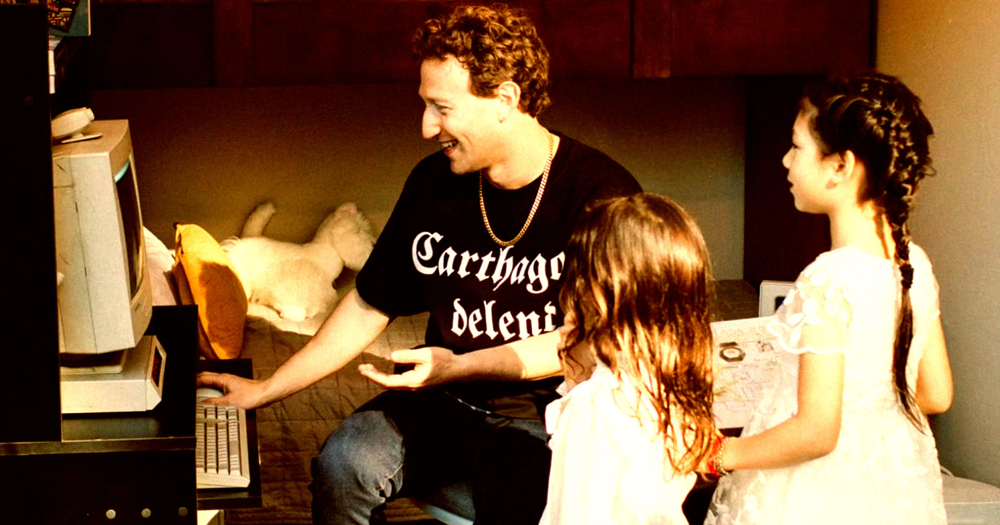

# 扎克伯格11岁女儿在学vibe coding，但妈妈划了红线

> Priscilla Chan在《Colossus》的专访中透露，11岁的女儿Maxima一直在用AI"氛围编程"做聊天应用和类FarmVille游戏，但做任何能接入互联网的东西都不行——比如"她想做一个约会网站"，被直接否决。

扎克伯格夫妇给自家孩子设下的AI边界，与众多科技高管如出一辙。

## 一边收割隐私，一边保护自家孩子

长久以来，Meta一直站在监控国家的最前线。这家公司积累了关于数十亿人的前所未有的私密数据，而对待这些侵入性信息的态度，有据可查地漫不经心。

CEO Mark Zuckerberg最钟爱的项目之一——带摄像头的AI眼镜——把这种对隐私的粗糙处理暴露得格外刺眼：在肯尼亚，数据标注外包人员会看到用户脱衣服的画面；公共街道上由智能眼镜拍下的性骚扰视频，平台也迟迟不予下架。

与此同时，Meta的平台正用潮水般的惊悚AI垃圾内容堵塞整个网络，其中不乏令人不适的儿童受虐视频——Meta告诉Futurism，这类画面并不一定违反其政策。

这就是Zuckerberg似乎想让自己女儿远离的那种反乌托邦环境——某种程度上的。

## "妈妈不让她做能连上网络的东西"

据《Colossus》杂志一篇关于扎克伯格夫妇的新专访，Zuckerberg的妻子Priscilla Chan颇为自豪地说，两人的11岁女儿Maxima一直在用AI"氛围编程"（vibe coding）做聊天应用和类FarmVille的游戏。（文章没有说明是哪个女儿，不过另一个只有三岁，恐怕还编不了程。）

但只要能接入互联网，对扎克伯格家的孩子就是禁区。

"她被限制得挺严的，因为妈妈不让她做开放到互联网上的东西。"Chan对《Colossus》说。比如女儿"想做一个约会网站"，答案是"不行"。

这些说法相当含糊——例如，女儿是否被允许跟能联网的聊天机器人互动，即便她不能拿它们去搭在线应用，文章并没有讲清。但它指向了一个由来已久的趋势：科技高管们一边靠这些工具赚得盆满钵满，一边限制自家孩子的接触。

从专访里也能看出，Chan确实相信氛围编程是让女儿"动手做东西"的一种有意义的方式。她称这种欲望是"天生的"、"自己冒出来的"——当然，跟她父亲几十年来近乎偏执地追求同一件事毫无关系。

"全是她自己在弄。"Chan告诉《Colossus》。

## 对发育中的大脑意味着什么，专家还没吵完

这类兴趣——以及无休止地暴露在AI垃圾内容中——会给发育中的大脑带来什么，专家们仍在争论。但早期形成的共识并不乐观。

一些研究者发现，这些垃圾内容正在污染孩子的大脑，尤其是暴力和极端主义内容，往往从审核的缝隙中漏过去。而正如Maxima的父亲心知肚明的那样，要确保未成年用户不接触到这类内容，远没有那么容易。

还有一重风险：未成年人转向AI聊天机器人寻找陪伴，从而陷入社交孤立——对一个科技CEO的幼女来说，这种可能性显得格外真实。
