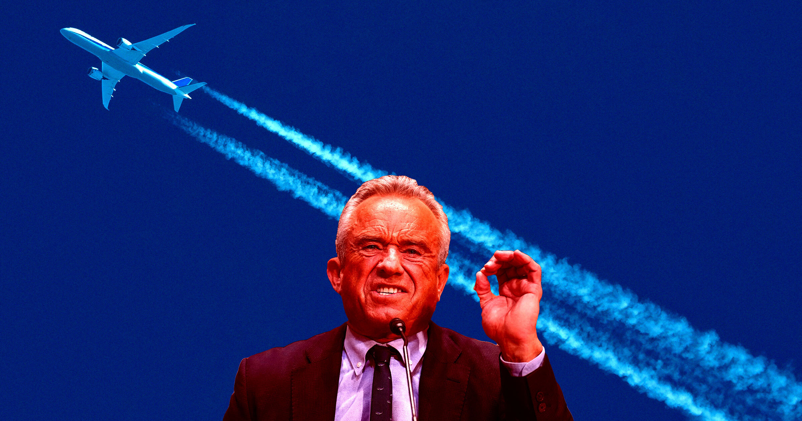

# 欢呼声中，RFK Jr. 宣布政府将调查“化学凝结尾迹”

> 美国卫生部长 RFK Jr. 在反疫苗组织 Children's Health Defense 的主题演讲中宣布，政府将对“化学凝结尾迹”展开调查，现场掌声雷动。

站在反疫苗组织 Children's Health Defense 的演讲台上，RFK Jr. 把流传已久的“化学凝结尾迹”阴谋论列入了官方调查清单。

## 掌声响起的那一刻

美国卫生部长 RFK Jr. 宣布，政府将对“chemtrails”（化学凝结尾迹）展开调查——这是一个流传已久的阴谋论，相信它的人认为，世界各地的飞机正在向天空秘密喷洒化学物质，用来改变天气，或者用生物制剂把大众控制在手中。

他是在反疫苗倡议组织 Children's Health Defense 发表主题演讲时作出这一表态的。这个组织正是他本人协助创办的，光是这一点就足以成为新闻。演讲充斥着各种离奇说法和未经证实的健康主张，但有一句题外话格外扎眼。

> “我们也在研究 chemtrails 及其排放的影响。”——RFK Jr.，现场随即响起一片掌声

他把这句话补完：“来自……呃，飞机的排放，以及它们对健康的潜在影响。”

## 事实并不复杂

对肯尼迪家族这位成员来说，这是一次彻底“摘下面具”的亮相。他在 CHD 现身，显示出自己在反疫苗立场上的张扬程度，已经超出了他出任特朗普政府卫生部长以来的公开尺度。

而 chemtrails 是这一切荒诞之上的那颗樱桃。事实本身并不复杂：飞机在天空留下的白痕是凝结尾迹（contrail），是喷气发动机排出的高温废气——主要成分只是二氧化碳和水蒸气——与高空冷空气相遇凝结形成的水汽，和冬天呼出白气是同一个道理。

这里没有任何需要调查的东西。退一步说，即便有，由 RFK Jr. 来调查也讲不通：这个阴谋论的核心恰恰是“政府在干这件事并且掩盖真相”。他去年就曾承诺要查 chemtrails，大约一个月后，美国环保署（EPA）正式驳斥了这一说法。

## 现实中的代价

与此同时，RFK Jr. 领导下的美国卫生机构正面对三十多年来最严重的麻疹疫情。宾夕法尼亚州是疫情中心，已记录超过 3300 例病例；而在他主导的美国疾控中心（CDC）拒绝对宾州卫生官员报告的某些麻疹死亡病例计数的争议，正在演变成一桩丑闻。

他操心的事情却仍是 chemtrails 那套无稽之谈——用几乎字面意义上的说法，他的头在云里。
