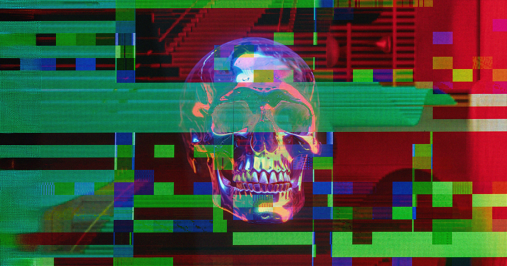

# 民调：多数美国人如今真的害怕AI

> Politico 一项覆盖2000多名成年人的最新民调显示，约三分之二的美国人认为先进AI至少有"中等"概率毁灭人类，还有17%的人"几乎确信"AI会终结人类。

最新民调显示，美国公众对AI的恐惧已经跨过党派界限，成为普遍情绪。

## 恐惧不分党派

据 Politico 今年9月进行的这项调查，约三分之二的美国公众认为，先进AI至少有"中等"概率毁灭人类。这一看法跨党派存在，差异并不大：2024年大选中投给 Kamala Harris 的选民中，有70%把AI视为中等或更高的生存风险，投给特朗普的选民中这一比例为60%。

更极端的判断也不在少数。17%的美国人"几乎确信"AI会把人类彻底消灭，且 Harris 与特朗普的支持者各占一半。反过来说，认为AI风险很小乃至没有风险的，只有22%。

## AI高管自己在火上浇油

这项民调恰逢AI业界领袖接连放出惊人之语。上周，一名 Anthropic 研究员辞职，指控公司"拿我们的性命赌博"，并称造这项技术的人"真心相信它可能杀死我们所有人"。风波之中，Anthropic 的 Dario Amodei 写了一篇长文，呼吁美国头部AI公司合作放慢开发节奏，还得到了 Elon Musk 与 OpenAI 首席执行官 Sam Altman 的背书。

确实有人怀疑业界的安全表态是作秀，但这看起来是少数派。民调显示，只有26%的人认为AI领袖警告生存风险只是营销噱头。总体而言，公众基本相信了AI领袖说的话。

## 都觉得该"暂停"，但怎么应对吵起来了

近半数美国人已经主张踩刹车：48%的人同意AI已足够强大，应当直接暂停开发。但在这一问题上党派分歧明显——特朗普支持者中只有44%持此观点，Harris 支持者则有58%。

反过来，28%的 Harris 支持者认为应继续开发强大AI以获取潜在收益，特朗普的支持者中这一比例为40%。对威胁是否真实，美国人高度一致；但该如何应对，意见明显分裂。
