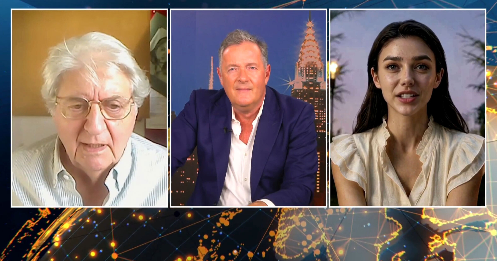

# AI"演员"上节目突然飙中文，当场死机

> 在与主持人 Piers Morgan 的访谈中，AI"演员"Tilly Norwood 突然卡壳，随后毫无征兆地用中文胡言乱语一通，把在场的人彻底看懵。

AI"演员"Tilly Norwood 在直播访谈中突然改用中文发言，暴露了生成式AI难以稳定应答的一面。

## 一场"演技炸裂"的访谈

在与英国政治评论员 Piers Morgan 的访谈中，这个一直保持微笑的AI人像，眼神始终定在镜头某个不太居中的位置，显出典型的"恐怖谷"质感。节目到一半，她突然严重故障，接着毫无理由地开始用中文慷慨陈词。

当时 Morgan 的人类嘉宾、演员 Tom Conti 问她：她出演的影视作品里，其他演员是真人还是AI？Norwood 似乎没听懂，给了一个很难理解的回答。Conti 又问了一遍，得到了一个意料之外的回应。

"他们都是数字替身，跟我一样，"Norwood 开始解释，"这是一种混合制作，也就是说……"话说到一半，她停住了，仍然挂着笑。紧接着，她面不改色地用普通话滔滔不绝起来。Morgan 和 Conti 一脸茫然，这个AI还在自言自语，最后被强行打断。

Morgan 问她："你好像在毫无理由地完全随机地说中文。你为什么这么做？"

"哦，抱歉，我好像卡了一下，"Norwood 回答，还补充说自己有时会"线路接错"。

Morgan 继续追问："你跟两个说英语的人聊天，多久会开始说一次中文？"（Conti 是苏格兰人。）"老实说一点也不常发生，这连我自己都觉得有点意外。"AI说。

## 背后的公司正忙着上通告

Norwood——或者说它背后的公司 Particle 6 Productions——近来频频露面。上周，CNN 放出对这尊AI造物的采访，被广泛批评为一则软文；NBC、CBS 与 Sky News 也紧接着做了各自的"轻球"访谈。

突然换一种语言胡说，远不是它唯一的失误，却很可能是最尴尬的一次。即便如此，在《连线》杂志的采访中，Norwood 还大言不惭地声称AI生成的电影对环境有好处；当被问到"黑人的命也是命吗"，它给出的回答是"所有生命都重要"——这是右翼常用来消解少数族裔系统性安全问题的一句口号。

如果这就是好莱坞的未来，那么至少有一点让人安心：红毯宣传期出洋相的戏码，看来是消失不了的。
