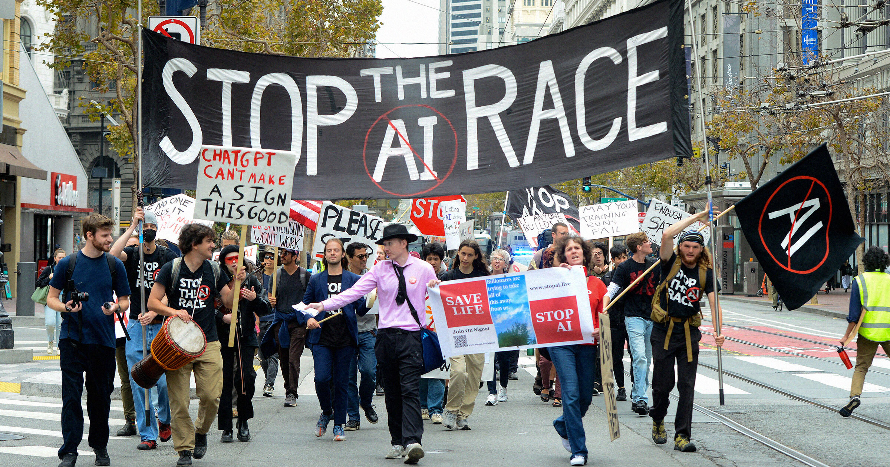

# 两党政客都不敢碰 AI 产业，尽管各自选民大多支持监管

> Politico 最新民调显示，若有迹象表明 AI 可能毁灭人类，62% 的美国人会选择停手；但民主、共和两党的政客都在回避批评 AI——一个出于恐惧，一个出于贪婪。

Politico 民调显示多数美国选民希望给 AI 建设踩刹车，但在 11 月中期选举前，两党政客都在回避这个话题。

## 一个假设，62% 的人选择踩刹车

Politico 近日对 2000 多名美国成年人做了调查，结果显示绝大多数受访者如果有得选，会直接叫停整个 AI 建设浪潮。问卷抛出的假设很耐人寻味：如果你正在开发 AI，并且开始看到这项技术可能毁灭人类的迹象，你还会继续吗？

答案很说明问题：只有 38% 的人说会继续，62% 的人说会停下来，并“希望其他实验室也看到同样的迹象并选择停止”。在自我认同为共和党人的受访者中，55% 表示会停下；民主党人中这一比例是 66%；即使是不确定立场的选民，也有 58% 选择踩刹车。换句话说，如果一场总统选举在反 AI 与挺 AI 的候选人之间展开，后者会被选票碾碎。

这个结果正戳在由全球最有权势的科技 CEO 们推动的 AI 安全叙事的要害上。知名投资人 Steve Eisman 形容，AI 亿万富翁们正在“制造一场危机”；这场围绕 AI 安全的密集公关，似乎反而放大了公众对这项越来越不受欢迎的技术的焦虑。

## 民主党顾问在悄悄劝阻

然而公众情绪再怎么转向，似乎也动摇不了两党的职业政客。Politico 的另一组报道披露，民主党顾问正私下恳求摇摆州的候选人不要在竞选途中批评 AI——逻辑是，如果民主党人全力抨击 AI 和数据中心，庞大的科技游说集团可能在 11 月中期选举前对民主党候选人发动一场“闪电战”。

被点名的候选人包括北卡罗来纳州的 Don Davis、俄亥俄州的 Marcy Kaptur 和德克萨斯州的 Henry Cuellar，据 Politico 对十几位党内人士的采访，他们所在的州都已被 AI 数据中心的开发商像切火腿一样分割殆尽。

> “这些 AI 集团会站出来说他们很担忧，说他们想要监管。可他们随后花大笔的钱去打败任何想要立法监管的人。”——华盛顿州众议员 Pramila Jayapal

## 另一边的焦虑

共和党人同样在为反噬效应焦虑。8 月中旬，共和党竞选策略师发出一份措辞严厉的备忘录，警告 AI 公司在中期选举前收拾好自己刺眼的公众形象——围绕数据中心的负面情绪让不少候选人措手不及。也有共和党高层直接否认 AI 安全叙事，比如总统特朗普，他近日就抨击科技领袖呼吁放慢 AI 开发。

总体而言，两党都不太可能支持一个约束或监管 AI 公司的政纲——民主党出于恐惧，共和党出于贪婪。这让 AI 究竟会在 11 月的选票上占多大分量变得难以判断。如同军费或外交政策，两党垄断的政治结构让美国选民没有机会对 AI 建设真正发声，而这场建设正在把有毒化学物质带进他们的社区，把他们的孩子推入心理健康危机，并吹起现代世界见过的最大金融泡沫之一。
