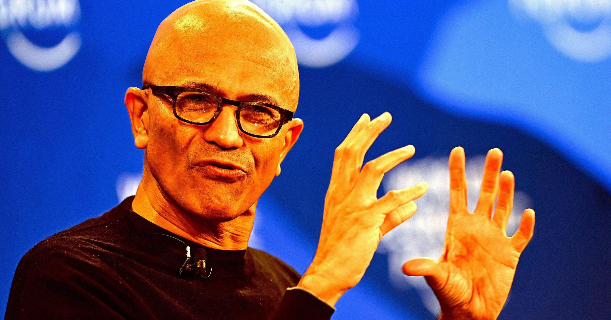

# 微软总监内部文件自曝：AI正制造吞噬整个网络的"末日循环"

> 在新解封的法庭文件中，微软多位高层——包括CEO Satya Nadella——承认其AI模型基本是在无偿窃取媒体内容，从而制造出一个既拖垮模型表现、又拖垮整个网络的"末日循环"。

《纽约时报》诉OpenAI的版权官司，把最大股东微软也拖上了被告席。

## 让AI高管自己开口

不受约束的AI公司是不是正在毁掉新闻业乃至整个媒体生态？这个道理本可以让我们长篇大论地论证一番，但为什么不直接让AI高管自己来说？

新近解封的法庭文件显示，微软的多位高层——包括CEO Satya Nadella——承认自家AI模型基本上是在窃取媒体公司的内容，却几乎什么都不回报，由此制造出一个将吞噬整个网络的"末日循环"。

这些令人瞠目的表态，来自《纽约时报》针对OpenAI的版权诉讼。作为OpenAI最大股东，微软也被一并拖了进来。《纽约时报》的律师援引了微软和OpenAI管理层此前的多段关键陈述来支撑其主张。

## 一份写在内部文件里的话

在微软应用科学总监Brent Hecht撰写的一份文件中，公司直接点明了AI公司与媒体平台之间这种单向的破坏性关系。

"我们的AI内容策略已经启动了一个'末日循环'，它会同时损害我们模型的表现和整个网络。"文件写道，"一个终端产品威胁到其关键供应商的经济根基，这是极不寻常的，但这正是我们为LLM业务围绕其'内容供应链'所创造出来的局面。"

坦白说，这话我们自己也说不出来。

Nadella用没那么激烈的措辞表达了类似的意思。据《纽约时报》律师引述，他在与AI聊天机器人对话时表示，这种方式"取代了……在网站上直接给你信息，你不再需要去访问原始来源"。

## 那条"绕过付费墙"的路子

据称，OpenAI在获取训练模型所需数据时并不太讲究，会动用各种手段在不被发现的情况下绕过付费墙。当一名员工向OpenAI联合创始人格雷格·布罗克曼（Greg Brockman）提到有一条"绕过"《纽约时报》付费墙的"小窍门"时，Brockman的回答很简短："啊，不错。"
