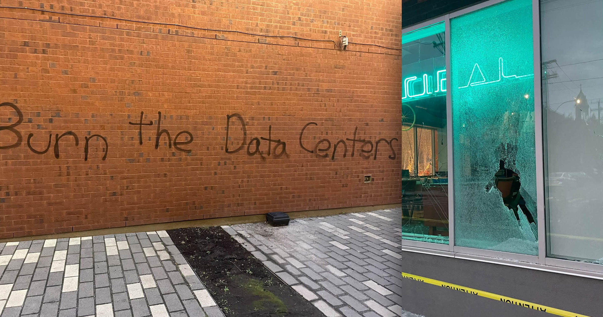

# 抗议者砸毁加拿大 AI 研究所，墙上喷下"烧掉数据中心"

> 蒙特利尔 Mila 研究所等两处 AI 机构办公室本周被约10人砸碎窗户、喷满反 AI 涂鸦，其中一句是"烧掉数据中心"；而仅在美国，AI 数据中心扩张所面临的社会风险已危及约1300亿美元投资。

蒙特利尔的 AI 研究机构窗户被砸、墙面被喷上反 AI 标语。

## 约十人夜里动手

对 AI 末日的焦虑正逼近沸点，世界上有些人已经不再要求监管了。本周早些时候，加拿大两家 AI 实验室的办公室被警方描述为一个有组织的破坏团体洗劫。

据 CBC 报道，位于蒙特利尔的魁北克人工智能研究所（Mila）一栋办公楼被破坏：窗户被砸碎，墙上被喷满反 AI 涂鸦。附近另一栋属于某未具名 AI 公司的建筑同样遭到破坏。CBC 发布的照片显示，其中一处喷涂的字样是"burn the data centers"（烧掉数据中心）。

## 警方称是有组织的作案

蒙特利尔警方发言人 Manuel Couture 在 CTV News 报道的一份声明中说："根据初步调查结果，作案者似乎是一个约10人的团伙。""大楼的窗户被砸碎，墙上被喷了大量涂鸦标签。"

CBC 报道，至少一名在现场附近被发现的25岁女子被带走问话，随后无条件获释。

## 从抗议到砸窗

这起破坏发生在针对 AI 及其支撑其扩张的数据中心的反弹不断升温之际。在美国，许多人因为在地方会议上抗议或违抗市政官员而被逮捕。温度高到什么程度？仅截至8月中旬，美国 AI 数据中心开发所面临的社会风险就已经威胁到约1300亿美元的投资。

蒙特利尔的破坏事件只是这股反 AI 民意的一个缩影：它说明如果民选官员继续无视民众，人们并不怕自己动手。
