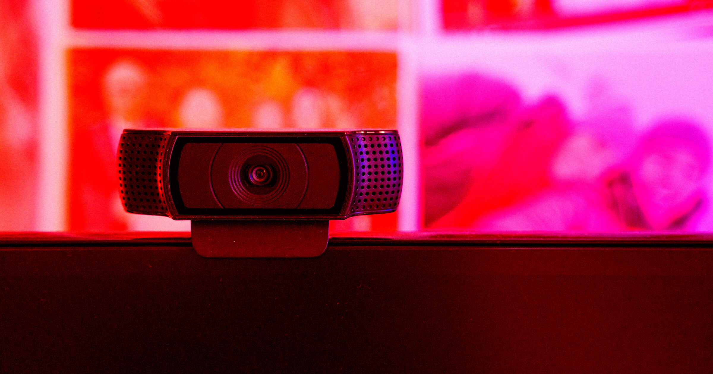

# 谷歌要你用"视频自拍"登录账号了

> 谷歌本周开始在自己的首页推送"用自拍登录"：录一段转头露脸的短视频就能进入账号。功能号称可选，但它同时会拿你的面部数据判断年龄，用户还可以授权把这些影像拿去改进谷歌的人脸识别系统。

谷歌开始向用户推送"用自拍登录"，一段转头露脸的短视频正在成为进入账号的新方式。

## 从"备用方案"变成首页弹窗

据 Search Engine Watch 发现，从本周起，谷歌开始要求用户通过录一段视频自拍来登录账号。这项功能目前仍是可选项，但它标志着人脸识别正被这家搜索巨头大力推广，一步步成为上网的常规方式。

谷歌最早在7月公布这项功能，当时把它定位成一种可选的备用方案：如果你被锁在账号外，或者手边没有常用的设备，就可以用脸进去。

设置流程是：录制一段短视频，期间转动头部以捕捉不同角度。此后"如果你日后遇到登录困难"，谷歌在公告里说，"你只要再拍一张自拍，就能回到账号里。"

真正的新变化在于，谷歌现在开始在首页上推销这项功能。屏幕底部会弹出一条提示，问你愿不愿意"用自拍登录"，选项是"暂不设置"和"设置自拍"。

## 它不只是在验证你是你

这套系统看起来承担的职责远不止确认账号归属。设置页面的免责声明里写明，视频自拍还会被用来判断你是否"到了使用某些谷歌服务的年龄"。

用户还可以选择勾选"改进谷歌服务"，这就意味着谷歌有权用你的视频自拍去"在谷歌各项服务中，改进我们的人脸识别、年龄估算，以及其他依赖你的身体特征或动作的验证方式"。

## 一张脸，就是一份人格数据

隐私和安全方面的担忧显而易见。谷歌本就对数以十亿计的用户收集了大量行为数据，用来优化搜索引擎、推送定向广告；如今再交出一张脸的数学地图，等于把更多"你这个人"的数据集中到了同一家公司手里。

更麻烦的是技术本身的可靠性。在 AI 深伪技术越来越逼真、越来越易得的当下，人脸识别扫描到底能不能扛住伪造攻击，目前还没有确定的答案。
