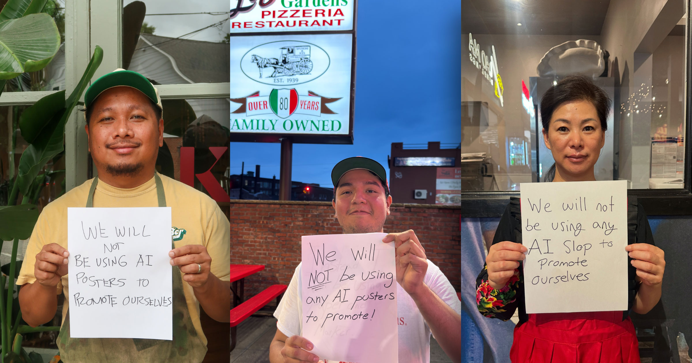

# 餐厅举着手写标语反 AI 走红：我们绝不用 AI 做宣传

> 生成式 AI 做出的宣传海报把餐厅招牌变成了「恐怖片现场」，如今一批厨师和店主索性举着手写纸条上镜，公开承诺不用 AI 给自己打广告，单条帖子能收获数十万点赞。

从被 AI 海报吓退的顾客，到主动举手写标语划清界限的店主，餐饮业正在用最朴素的方式表达对 AI 宣传素材的抵触。

## 被 AI 海报吓跑的顾客

生成式 AI 的诱惑，正在把面向公众的广告牌和餐厅菜单变成一场洛夫克拉夫特式的恐怖秀。过去几个月里，看起来像「爬行动物皮肤」的面包、形似「外星幼虫」的牛角包，一直在劝退潜在顾客。

店主们原本想靠 AI 降低宣传物料的成本，结果适得其反——那些倒人胃口的招牌让社交媒体上的用户纷纷点名批评本地商家。404 Media 上个月最先注意到这一现象，随后一些餐厅终于反应过来：这场失败营销其实可以反过来利用。店主和厨师开始把自己举着手写纸条的照片发到网上，纸条上写着各种版本的「我们不会用任何 AI 来做自我宣传」。

## 从一人发帖到集体跟风

自 404 的报道刊出后，这股潮流迅速蔓延。知名厨师纷纷加入，包括《Chopped》冠军、南卡罗来纳州的 Nikko Cagalanan，布鲁克林的西西里披萨连锁 L&B Spumoni Gardens，凤凰城的 Niu Mama 等，都承诺不用 AI 做自我推广。

其中一些帖子拿到了数十万点赞和数百条评论，说明它确实戳中了人们的神经。这也是反对 AI 情绪不断升温的最新信号——这项技术正渗入我们生活的几乎每个角落，而且往往违背我们的意愿。这种情绪已经从单纯的厌烦升级为公开愤怒，尤其是当污染严重的数据中心在国内各处不断冒出来时，还催生了跨党派的声讨。

## 餐饮业尤其敏感的神经

在美食领域，这个话题格外棘手。烹饪一直是人类表达的一种形式，深深扎根于文化价值之中，而 AI 模型本质上并不具备这种能力。

在他看来，靠 AI 想象出那些无意间令人不适的图片，餐厅其实发出了一个再清楚不过的信号。《纽约客》在一篇关于这股潮流的文章里写道，那些 AI 图片就像一句潜台词：「没错，我们确实卖吃的，但那是垃圾食品（slop）——就像我们拿来推销它的照片一样。」——很可能是冷冻、工厂批量生产，扔进积满油垢的炸锅，咬下第一口时居然还是温吞而软塌的。

反过来，只要公开承诺不用 AI——哪怕只是一张随手写就的手写纸条——商家就能轻易赢回顾客的信任，社交媒体的反应便是明证。

> 「这才叫钓鱼。」——一名用户回复 Cagalanan 举着反 AI 纸条的照片时说。

还有人留言：「刚多了一个新粉丝，马上就去你们家！」
