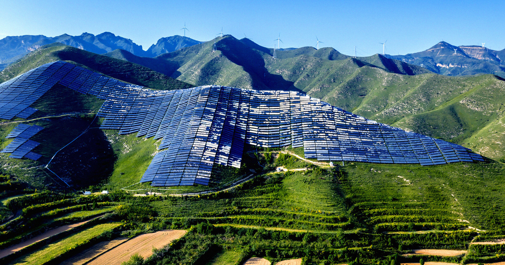

# 太阳能正变得极其便宜，几乎难以置信

> 26年前每瓦5~6美元的太阳能板，如今仅售12美分——中国制造的狂飙让太阳能价格跌至难以置信的地步，全球能源格局正在被颠覆。

光伏板价格暴降至12美分/瓦，中国产能爆炸推动全球太阳能革命。

## 从$5/瓦到12美分：一场价格革命

安装新太阳能电池板的成本一直在走低，但现在它正式达到了一个新的里程碑：便宜得刺眼。

《金融时报》最新报道揭示了光伏技术正围绕传统能源网络展开颠覆——近乎无限的供应量直接催生出令人震惊的低价。

埃姆伯（Ember）能源研究公司联合创始人戴夫·琼斯告诉FT，26年前太阳能电池板每瓦发电能力要卖5~6美元。如今，琼斯表示电池板仅售12美分一瓦，他评价这是「令人难以接受的便宜」，尤其是拿它跟其他选择一比较。

《金融时报》将这种令人 jaw-dropping 的价格暴降完全归功于中国太阳能板产量的爆炸性增长——这种增长正以底价将可再生能源提供给富国和穷国。

## 发展中国家的生活正在被点亮

在世界偏远农村地区，这意味着一家人从烧两三盏煤油灯，变成了每天开启一盏比原来亮20到40倍的灯。肯尼亚太阳能融资公司Sun King联合创始人阿尼什·塔克拉告诉FT说的正是这个场景。

随着进入太阳能世界的门槛不断降低，光伏发电量正在达到前所未有的高度。

## 中国：装得太多，电用不完

中国作为不容置疑的可再生能源世界领袖，新的清洁能源装置正以比电网能消化更快的速度往里注电。电池巨头BTR新材料集团执行副总裁黄友元在《财富》杂志报道的一场论坛上说：中国电网是非常强壮而稳定的，但我们安装了太多绿色能源。

## 美国：光伏首次干掉煤电

在美国，绿色能源建设同样正在制造新闻。尽管唐纳德·特朗普总统努力想复兴衰落的美国煤炭行业，光伏发电在6月首次生产的电量超过了烧煤发电机。

## 西班牙：太阳能把能源经济翻了个底朝天

而在西班牙，「单纯令人难以置信」的太阳能板安装量把国内能源经济完全颠倒过来——结果是风险资本大规模撤离，因为客户得被付钱才能用更多电。

## 买太阳能板的最佳时机

总之，买太阳能板从来没有这么划算过——这在原油市场摇摇欲坠之际尤其是个利好消息。
