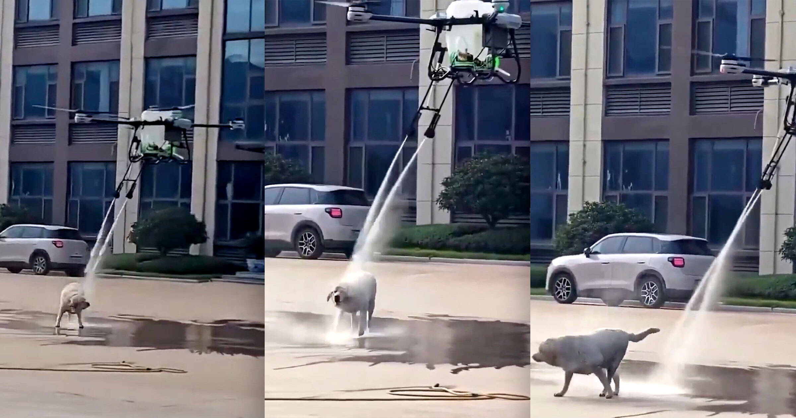

# 巨型无人机悬停给小狗冲澡，背后是中国光伏清洁无人机的演示

> 一段号称拍摄于山东临沂的视频里，一架带软管喷头的四旋翼无人机悬在一条小狗头顶给它冲澡，小狗摇着尾巴颇为享受——这不是宠物服务，而是一家研发光伏板清洗无人机的中国公司的演示。

视频里的小狗被无人机淋得浑身湿透，摇着尾巴原地甩水。

## 视频里发生了什么

这段疯传的视频和标题承诺的一模一样：一架装着软管喷头的四旋翼无人机悬停在一条圆滚滚的小狗上方喷水，给它冲了个小澡。狗看上去心情不错，任由自己被淋透、尾巴摇个不停，最后抖了抖身上的水慢悠悠走开。剧终。

"狗类几百万年的进化史，从没为这种场面做过准备。"Reddit 上有人这样调侃。也有人的联想立刻滑向更阴暗的方向："我能想象出用催泪瓦斯搞人群控制的某种版本。"

据视频聚合平台 Spectee（经 ReutersConnect 分发）称，这场临时狗澡是一家中国企业做的演示，该公司研发用于清洗太阳能板的无人机——具体是哪一家并不清楚。Futurism 未能独立核实视频来源。

## 一千三百吉瓦背后的清洁难题

在中国，会飞的太阳能板清洁机器确实有市场。中国是全球光伏装机的绝对领先者，装机容量接近1300吉瓦，位于青藏高原的最大光伏电站绵延超过162平方英里。

清洗如此庞大的太阳能基础设施，是一道棘手的物流难题。在光伏板上爬行的机器人是一种方案，中国部分城市已经用它们在屋顶阵列上作业；科研人员则在开发可以涂在板面上的自清洁涂层。

出动一支无人机大军给太阳能板冲水，是不是最实际的办法？会不会浪费水？如果这些无人机还能兼职做随叫随到的狗澡服务，这笔账就算得过来了。
