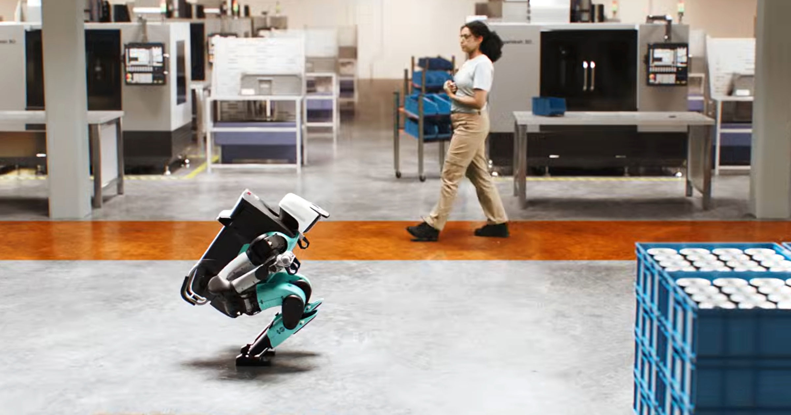

# 新的人形机器人会在你靠近时「吓得」跪下

> 机器人公司 Agility Robotics 发布新款人形机器人 Digit 5，当有人拐过角落走近时，它会像受惊一样屈膝跪下——这是它避免与人类碰撞的一套安全动作。

Agility Robotics 的新款人形机器人 Digit 5 搭载英伟达定制 AI 芯片，会主动避开、停下或就地蹲下，以免和人类发生碰撞。

## 会「害怕」的机器人

把机器人放进仓库之类与人共处的工作场所，需要权衡的安全问题不少：故障、受伤、火灾，极端情况下甚至可能致死。随着两条腿的人形机器人同事越来越靠近现实，一些公司开始认真对待「强力机器与人近距离共事」的后果。

机器人公司 Agility Robotics 本周发布其最新款「通用」人形机器人 Digit 5，就是一个例子。它依靠「专有 AI 算法」和传感器，「持续监测是否有人在场，并自主做出恰当反应：避开、停下或采取坐姿」。

落到实际动作上，就是当有人拐过角落走过来时，这个壮实的机器会显得颇为惊惧地蜷缩起来、跪倒在地——这在公司的一段宣传视频里（大约第 43 秒处）可以看到。在一个人类利益正迅速让位于 AI 需求的世界里，这种新奇的互动关系反而带来一种奇特的安心感。Digit 5 能自主决定是让开迎面走来的人，还是在有人经过时原地不动。

> 「这款机器人设计了一套复杂的安全运动系统，能根据探测到的是何种人类在场情况，采取多种不同的应对措施。」——Agility Robotics 首席技术官 Pras Velagapudi 对 Ars Technica 说。

## 已经在亚马逊和丰田的场地里干活

Agility 已在把机器人车队部署到商业运营上前进了不少，客户包括亚马逊和丰田。通过加码安全性，公司希望进一步提升自身的商业吸引力。

Digit 5 搭载一颗来自英伟达的定制 AI 芯片，型号为 Thor IGX，用于持续监测附近是否有人。它从一系列基于视觉的传感器采集数据，再靠板载芯片实时识别任何移动。它还能反复举起最重 50 磅的重物，公司称这使其「在 OSHA 监管的场所中能完全覆盖单人搬运任务」。

续航方面，它的电池可支撑 90 分钟，充满只需 9 分钟，「从而在 24 小时的一天里实现超过 20 小时的有效工作」。

## 方向至少是对的

随着人形机器人不断进入人类的工作场所，安全顾虑被认真对待是件好事。如果人类靠得太近，机器人会跪下来——这显然比反过来让人类给机器人让路，要让人踏实得多。
