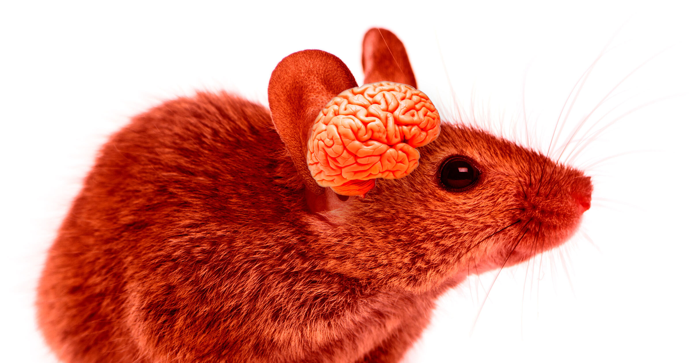

# 科学家造出大脑近一半是人类的"科学怪鼠"

> 斯坦福团队培育出脑中融入数百万个功能性人类神经元的小鼠：这些人类神经元从几百个暴增到数百万，并成功与小鼠大脑建立连接。按体积算，这些小鼠近一半的大脑已经是人类组织。

这些小鼠表面行为正常，但当出生时缺氧，它们表现出了人类婴儿才有的脑损伤迹象。

## 先挖空，再植入

在一项发表于《Nature》的新研究中，斯坦福大学的科学家报告了他们如何用基因工程刻意让小鼠的大脑中缺失一部分——具体是名为"皮层"的关键区域。同时，他们还剥夺了小鼠补充这些皮层神经元的能力，从而腾出一块可以植入人类脑细胞的空间。

被植入的人类神经元不仅存活下来，还大幅增殖，从区区几百个神经元扩散到数百万个，并成功与小鼠大脑建立起连接。小鼠本身则大体表现得一如平常——尽管按体积计算，它们近一半的大脑已经是人类的。

"过去二十年，人们一直在努力尝试在人体之外构建人脑模型。"论文资深作者、参与这项研究的斯坦福精神病学教授Sergiu Pașca对NPR说，"这不会取代我们此前所有的模型，但它能让我们接触到人脑功能中那些原本极难研究的方面。"

## 缺氧实验里的"人类反应"

这项工作是人脑类器官（在实验室中培养的、小簇的人脑组织）领域一次惊人的飞跃。研究人员使用人类皮肤细胞，对它们重新编程，使其形成皮层中的神经元。

皮层之所以重要，是因为它是"让我们之所以为人的那部分大脑"，加州大学圣迭戈分校生物伦理学家John Evans对《纽约时报》说——它掌管着我们的高阶思维和语言能力。Evans并未参与这项研究。不过，被植入的人类神经元并不成熟，更接近妊娠晚期胎儿体内的细胞。

尽管这些小鼠大体活动、行为正常，却表现出一些类人的关键差异。当研究人员在幼鼠出生前后剥夺其氧气时，这些带有人类神经元的鼠类显现出脑损伤迹象。这一点很惊人：正常小鼠幼崽在低氧环境中极少出现脑损伤，而人类婴儿却常常如此。

"这是研究这种毁灭性疾病的一个理想范例。"Pașca对《纽约时报》说。

## 一种只有高社交性动物才有的神经元

他们还发现，小鼠大脑中的人类部分包含一种细长的特化脑细胞——von Economo神经元。这种神经元只存在于人类、猿类、鲸和海豚等高度社会化的动物体内。关键在于，von Economo神经元是额颞叶痴呆患者体内最先死亡的脑细胞之一，它们在鼠脑中出现，有助于探究这种罕见疾病中这类细胞扮演的角色。

## 该在哪里叫停？

这个项目也引发了敏感的伦理问题。杜克大学法学院法学与哲学教授Nita Farahany提醒，研究人员恰好在大脑细胞长到六个月时就终止了实验——此时它们还没来得及与小鼠大脑形成更多连接。

"他们试图在意识标记、或者说意识本身可能出现之前就停下研究。"Farahany对NPR说，"但这条线本身，就是你可能会开始纠结的一条线。"

"如果一只动物有潜力、或者正走在发展出意识的路上，你会不会在它发展出意识之前就叫停实验？"她接着说，"它是否拥有我们应当赋予它的、不同的利益或权利？"
