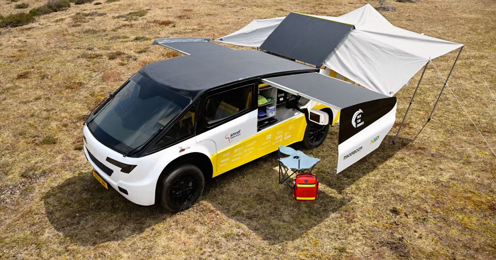

# 荷兰学生造出太阳能救护车，要开进肯尼亚偏远村落

> 荷兰埃因霍温理工大学的学生设计出一款名为 Stella Juva 的太阳能电动救护车，造型酷似 Cybertruck，续航超过444英里，车上配着超声、X光、除颤器和疫苗冰箱，眼下正被派往肯尼亚部分社区实地测试。但一辆再亮的电动车，也补不上肯尼亚急救体系连统一急救号码都没有的窟窿。

荷兰埃因霍温理工大学学生设计的太阳能电动救护车 Stella Juva，正被派往肯尼亚偏远社区测试。

## 一辆"轮子上的诊所"

肯尼亚有相当大一部分人口住在偏远村落和小镇，远离城市生活提供的各种便利。尽管近几十年农村人口有所下降，它依然占全国人口的绝大多数，这给本就吃力的肯尼亚医疗体系出了道大难题。

半个地球之外的一群学生想帮忙。据 EuroNews 报道，荷兰埃因霍温理工大学（Eindhoven University of Technology）的学生设计了一款太阳能电动救护车，目标是改善偏远社区的急救医疗可及性。

这款车名叫 Stella Juva。据说它的构想来自与多家在非洲改善医疗可及性的非政府组织的讨论。它造型明显是 Cybertruck 那一挂，设计用途既包括运送急救医疗物资，也包括开展基础体检的设备——与其说是救护车，不如说是一间装上轮子的诊所。

按 EuroNews 的说法，车上配备了超声扫描仪、X光设备、除颤器，以及一台用于运送疫苗和其他物资的冰箱。

"它让我们能去给母亲和婴儿做筛查，及早发现并发症，并实时转诊。"非营利组织 Amref Health Africa 的项目官员 Geoffery Sadera 对 EuroNews 说。

## 续航够长，速度不快

这台电动车的综合续航超过444英里（约715公里），最高时速不到75英里（约120公里）。目前，Juva 正在肯尼亚多个社区试点，以检验一辆纯太阳能救护车在真实条件下究竟有多可行。

## 再好的救护车，也得先有人接电话

只是，无论这样的开发多令人兴奋，肯尼亚仍面临一连串不是靠几台时髦电动车就能解决的障碍。正如肯尼亚审计长办公室（Office of the Auditor General）在2025年一份报告中指出的，这个国家至今没有像"911"那样统一的免费急救号码——这只是肯尼亚公共卫生体系众多系统性缺口的一个缩影。

由于急救调度是按郡（county）各自组织的，肯尼亚大部分地区的急救服务连最基本的要素都缺：受过训练的调度员、稳定的网络、应急备用电源，更不用说电子化的呼入记录和实时响应追踪这样的物流系统了。

在 Emergency Medicine Kenya Foundation 对这份审计报告的总结中，只有26%的公众知道紧急情况下该拨哪个号码。即便救护车派出，全国平均响应时间也在20分钟到1小时之间——而这还是对那些确实有调度数据可分享的郡而言的。

"肯尼亚的应急响应在很大程度上是不协调的、被动的，取决于地理而非需求。"该基金会解释说。而这还没算上创伤病人送到之后，肯尼亚医院和诊所里的条件。

在这样的背景下，几辆太阳能救护车当然不会有什么坏处——但如果没有对肯尼亚医疗体系的重大改革，它们很可能只是贴在慢性伤口上的一枚创可贴。
