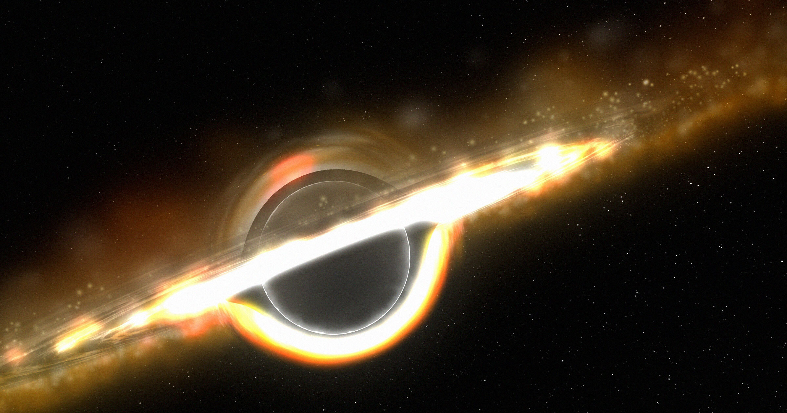

# 韦伯望远镜拍到的"小红点"，可能是超大质量黑洞的种子

> 詹姆斯·韦伯太空望远镜在宇宙诞生仅数亿年的区域拍到一批神秘的"小红点"。发表在《自然》上的新论文用数值模拟证明，它们可能是正在快速长大的超大质量黑洞"种子"。

韦伯望远镜观测到的"小红点"或为早期宇宙中飞速成长的"超重"黑洞。

## 困扰天文学家的"小红点"

多年来，科学家一直被美国宇航局詹姆斯·韦伯太空望远镜观测到的"小红点"（little red dots）困惑。这些天体出现在他们认定属于大爆炸后仅数亿年的区域，也就是已知宇宙中最古老的街区之一。

各种解释随之涌现：有人认为它们是正在形成的星系，也有人提出，这些红点可能是超大质量黑洞的最初阶段——那类由引力坍缩形成的庞然大物，通常潜伏在星系中心。

## 用模拟造出的"种子"黑洞

本周发表在《自然》期刊上的新论文中，马克斯·普朗克天体物理研究所的 Sunmyon Chon 与同事深入检验了后一种可能：他们模拟了宇宙最早期阶段，发现快速形成的黑洞在吸积物质时会发出光，呈现出来的样子正好对应韦伯望远镜捕捉到的那些神秘红点，也就是所谓的"种子"。

尽管黑洞几乎遍布我们望向的每一处宇宙，它们的本质依然成谜。科学家仍在积极探索新的黑洞类型，红点也可能属于我们尚未归类的一类。

Chon 和同事提出，新形成的"超重"黑洞会"迅速发展出致密、光学厚的吸积盘，其强烈的电子散射会产生宽氢阿尔法（hydrogen-alpha）发射线，强度与小红点中观测到的相当"。氢阿尔法是一条特定的可见光谱线，落在光谱中一段很深的红色区域。

## 50万年像小红点，100万年吞光周围气体

研究团队推测，这些黑洞会演化成"超重"类星体——由超大质量黑洞吞食气体驱动的极亮天体，而韦伯望远镜确实探测到了这类天体。他们认为，这些黑洞可能就是"今天超大质量黑洞的祖先"，整个演化过程可能用不到十亿年。

Chon 对《纽约时报》描述了这个过程的时间尺度：在50万年时，它看起来像一个小红点；但大约一百万年之后，周围的气体已经基本被吸积进黑洞里了。

## 学界尚未形成共识

不过，更广泛的科学界还没达成一致。剑桥大学天体物理学家 Roberto Maiolino 就对《纽约时报》表示，他更倾向一个更熟悉的解释：红点只是普通黑洞演化过程的一部分。

Chon 本人也对这一理论的可靠性保持开放态度。他说，他们不想宣称所有小红点都来自模型所描述的情形，因为新发现层出不穷，这对新的模拟来说是好事。

对小红点的追查才刚刚开始，而它牵出的问题——宇宙最早期的巨兽究竟是怎样长起来的——可能要再等下一代望远镜才能回答。
