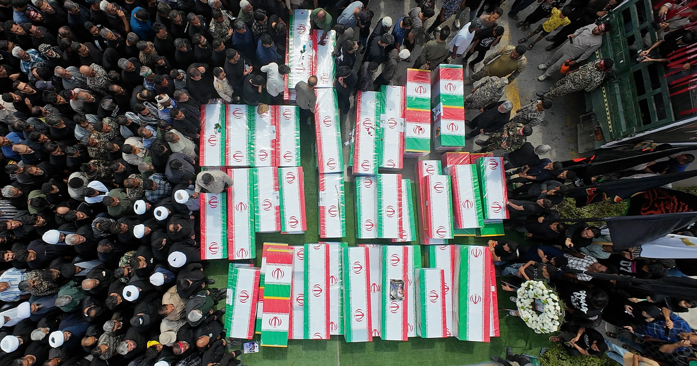

# 五角大楼调查证实：美军用AI锁定并炸毁伊朗女校

> 彭博社披露的五角大楼调查报告显示，今年2月28日对伊朗 Shajareh Tayyebeh 女校的双击空袭，造成150多人死亡、其中至少123名儿童，原因是情报过期加上对AI目标锁定系统的过度依赖。

美军将AI系统用于目标选择，被认为是2月女校空袭悲剧的关键一环。

## AI不只写宣传稿，还负责挑目标

美国对伊朗开战已超过半年，AI在这场战役中的作用越来越清晰。在国内，AI及其基础设施悄然左右着意识形态战场：总统特朗普不断抛出由生成式AI拼凑的战时宣传，而美国所有的数据中心与科技公司办公室，也已被广泛视为合法的军事打击目标。

更关键的是，AI正在帮助美国中央司令部挑选要用无人机或导弹摧毁的目标——作用之大，以至于一套AI系统在一桩美国战争罪的成因中扮演了核心角色。据彭博社最新报道，五角大楼对2月28日 Shajareh Tayyebeh 女校空袭的调查得出结论：这场造成150多人死亡、其中至少123名儿童的双击打击，是过期情报与对AI目标锁定系统过度依赖共同导致的结果。

接受彭博社采访的匿名军方调查人员，把这场骇人袭击描述为一连串小"错误"的叠加，而非单一的不幸失误。这些源于陈旧情报的错误，似乎又被一套尚未公开身份的AI目标系统放大——它很可能与美军在冲突初期四天窗口内快速批准打击2000多个伊朗目标所用的系统类似。

## 与总统的说法直接冲突

最新信息直接打脸了特朗普本人对这场致命事件的叙述。今年7月，特朗普淡化美国的责任，甚至暗示大屠杀的图片和视频可能是AI生成的。然而正如联合国实况调查委员会上周在报告中写的那样，有"合理理由"认定美国的袭击构成"战争罪"，女校空袭只是其中最突出的一个例子。

五角大楼的完整调查报告是否会被公开，目前不得而知。可以确定的是，杀人AI已经到来——它不需要有自我意识，就足以帮人类夺走数百条无辜的生命。
