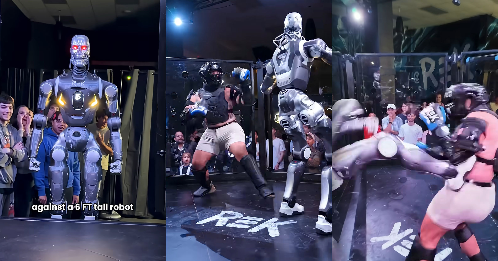

# 史上首场"人类对战机器人"MMA：网红被六英尺铁疙瘩踢飞

> 机器人格斗公司 REK 放出一段44秒视频，让旗下人形机器人戴上"终结者"式头颅，在八角笼里对决网红 Frankie LaPenna——他被连续踢中胸口，最后被一记踢击甩过整个擂台。

REK 的六英尺人形机器人在八角笼里与网红 Frankie LaPenna 对打。

## 44秒里挨了一顿踢

机器人的时代到了。我们见过人形机器人表演漂亮的武术套路、跑得比世界上最快的人还快、在舞池里撒欢，也见过它们在擂台上互殴。但除了少数在失控特技中被机器人误伤的人类，我们还从没见过机器人与人类拳手在擂台上正面对峙。

直到现在。社交媒体上流传的一段新视频显示，人形机器人格斗公司 REK 让旗下的一台机器人，与网红、TikTok 大 V Frankie LaPenna 对打。LaPenna 的成名技能之一是往短裤里塞东西，让自己看起来有个巨大的臀部——他红到登上 NBC 的《America's Got Talent》，最终被判定没有晋级。

"历史上第一次，人类面对一台六英尺高的机器人。"视频里的解说员喊道。一名场边裁判笑着对 LaPenna 说："哥们，我真替你害怕。"

## 被一脚踹过整个擂台

这段44秒的视频里，裹着厚护具的 LaPenna 在铺着塑料膜的八角笼里向那台威猛的机器人挥拳，但毫无效果。这场短促的对决中，他反复被踢中胸口和腹部，最后被一记踢击甩过整个擂台，看上去比赛就此结束。（那台机器人还颇有戏剧效果地装了一颗吓人的"终结者"式头颅。）

## 是真打不过，还是演给你看

人类勇士对战机器，确实有它的娱乐价值，但这场比赛明显有不对劲的地方。首先，LaPenna 显然很难打出一记像样的攻击，这让人怀疑他在收力，甚至最终是在配合输掉比赛。其次，那台机器人是否真有力气用一记简单踢击把 LaPenna 甩过整个擂台，至少是值得怀疑的。

Reddit 上有人问："这到底是表演，还是那台机器人真的把那人扔出去五米远？"另一位网友则阴森地补了一句："它现在还是很笨拙……至少目前是。"

何况，这位28岁、身材敦实的网红以在公众面前扮演反派著称，为了喜剧效果愿意把自己扔进危险里。他最近分享的视频包括骑自行车撞办公桌、站在船上比武，甚至在狂怒的公牛旁边打牌。

## 真打起来会公平吗

换句话说，真正的 MMA 选手对上一台六英尺高的机器人会怎样，目前还没有定论。但考虑到对手的构成，我们斗胆猜一句：这大概不会是一场公平的较量。毕竟，人类远比一具金属和塑料拼成的机器更容易淤青。
