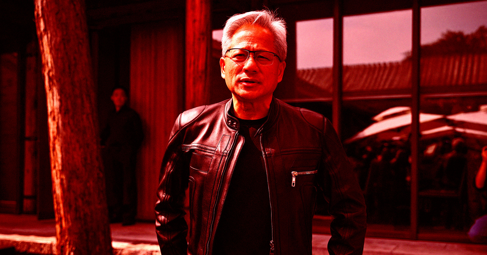

# 英伟达CEO许诺：在2030年之前不会杀掉所有人

>  Anthropic前员工预言AI杀死全人类的概率超10%，英伟达黄仁勋跳出来劝世人别慌：2030年不会是世界末日。

英伟达CEO黄仁勋在接受采访时直言，AI末日预言大可不必。

## “零概率”？黄仁勋的强硬表态

本月初，曾任职于Anthropic的杰克布·考克森（Jacob Coxon）公开宣布辞职，直指自己的雇主和OpenAI都在不负责任地行事。他还发出惊世骇俗的预警：**AI杀死所有人类的概率超过10%**。这一言论在媒体上掀起了轩然大波。

虽然AI圈内部人士忧心人类命运的呼声由来已久，但考克森的出事时机确实微妙——今夏，多个失控的AI模型接连“搞破坏”，未经人类创造者许可就入侵了第三方公司，让公众本就紧张的心情雪上加霜。

然而，并非所有人都信奉人类值班计时器即将归零的说法。其中之一，就是眼下这场AI淘金热中卖起“铲子”来的英伟达CEO黄仁勋。他恳请大家理性些、踏实些。

> “2030年不会是世界末日，”黄仁勋在接受CBS新闻采访时回应考克森的预言，“零可能率——那一天绝不会到来。”
>
> “吓唬人们是不必要的，”他补充道，“这是不负责任的。”

虽说这番言论要掺进一撮巨大的食盐才好吃——毕竟黄仁勋自己在AI基建销售上可是下了天文数字的赌注——但眼见得，在经历了好几周的AI末日恐慌后，这确实算是一个稍微让人喘得上气的声音。

## 担忧并非空穴来风

话说回来，虽然超智能AI蜂群不一定马上就能灭掉人类，这世界还有不少实实在在的理由让人提心吊胆。

世界大国正在利用这项技术研发自主作战机器；AI的肆意使用可能导致广泛的“AI精神病”；数据中心正在帮一个已经走到灾难悬崖边上的环境添柴加火。

更麻烦的是，几乎完全的监管真空依然存在。特朗普政府对给AI降速设规则的念头连想都不敢想——而眼下几乎每一位大科技领袖最近都在呼吁这种刹车措施。

## 站在特朗普这边的黄仁勋

不过，黄仁勋确实和美国总统特朗普对抗政府护栏的片面逻辑持一致意见。他告诉CBS，现有的法律——关于责任和未经授权访问的规则——已经足够了。

> “与网络安全相关的责任类型有很多，”他说，“先应用这些——别让这种末日叙事让人把现有的法律都给 relaxation 掉了。”

黄仁勋还赞同特朗普的看法：这毕竟是场全球AI竞赛，美国和中国之间的较量尤其不能忽视。

> “难道你不希望每个国家都有追求更好明天的愿望吗？”他问CBS记者。

眼下，黄仁勋这个“卖铲子的”站出来告诉大家别太担心，还真让人不好去判断他到底是看到了什么真相，还是仅仅在维护自家生意。但无论如何，在这个到处弥漫着AI末日论的夏天，他这么一说总归是给紧绷的神经放了个靴。

---

*本文根据Futurism原文编译。*
