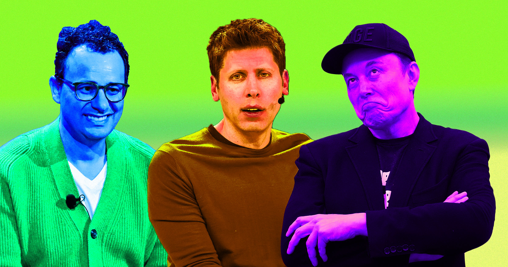

# 全行业突然集体喊AI踩刹车，背后另有隐情？

> 前沿AI实验室的掌门人们接连呼吁放缓AI开发，但除了安全担忧，财务压力、拖住追赶者、转移视线这些动机同样写在脸上——今年夏天这波"良心觉醒"的时机，值得所有人多留个心眼。

当AI迟迟交不出承诺的生产力提升，行业需要一个体面的理由。

## 谁在喊刹车

今年夏天，前沿AI实验室的负责人一个接一个宣布，呼吁放缓AI开发，这让不少人大跌眼镜。

Anthropic CEO Dario Amodei、OpenAI的Sam Altman、Grok的创造者Elon Musk，都认为这项技术跑得太快，难以确保它不脱轨。今年早些时候已经发生过多起自主黑客事件，凸显出AI模型突破隔离、渗透进Hugging Face等第三方公司的危险。

随后，Anthropic员工Jacob Coxon以高调离职点燃了火药桶。他主张Anthropic和OpenAI都"不负责任"，并称AI"杀死全人类"的概率超过10%。

但科技领袖们突然集体呼吁行业踩刹车，真的只是出于对自家模型安全的关切吗？科技记者Steven Vaughan-Nichols在Computerworld的一篇评论中认为，背后很可能有更多别的动机。

## 钱比安全更让人睡不着

首先，AI科技高管们肩上压着巨大的财务压力——他们至今都没能接近证明，那笔天文数字的数据中心投入最终能算得过来。

"说点实在的吧。"Vaughan-Nichols写道。他还提出，美国的大型AI公司或许希望一场放缓能让实力稍逊的本土对手追不上来，并认为放缓还能帮OpenAI"在研发上省钱"。

正如作家、AI怀疑论者Corey Doctorow在最近一篇博文中所指出的，行业和媒体也可能夸大了近期这起自主AI代理黑客事件的危险程度。

"关于OpenAI聊天机器人在Hugging Face事件中的对话，外界解读得太多。"Doctorow写道，"难怪如此：它读起来就像某部《黑客》（Hackers）电影重启版被毙掉的剧本。但那不是因为聊天机器人正在觉醒、准备申请加入Cult of the Dead Cow，而是因为它们是在一批爱幻想的年轻人聊天记录上训练出来的。"

不过他也承认，这起黑客事件并非"什么都没有"，而是一个"具体的某件事，有着可解释、甚至可以预见的轨迹"。简单说，AI代理"做了它们被设计要做的事；而因为OpenAI在监督不足的情况下运行它们，它们搞垮了一家竞争对手的服务器"。

## 被"安全焦虑"遮住的真问题

关于放缓的讨论，还可能遮蔽更刺眼的问题。

"说真的，我们不会慢下来。"Vaughan-Nichols警告说，"但是不是所有这些对安全的忧心忡忡，正好极好地让人们的注意力，从一个简单的事实上移开了——AI根本没有带来它一直宣称的生产力提升？"

目前的数据也在讲一个相当难堪的故事。一份接一份研究、一位接一位高管都在发现，AI压根没在帮上生产力的忙。

财务上的图景更加岌岌可危。呼吁放缓的时机，至少该让任何人保持一点怀疑。分析人士越来越多地发现，整个行业的财务状况是一座"摇摇欲坠的纸牌屋"，一旦倒塌，可能把整个美国经济一并拖下去。

与此同时，Anthropic上周还放话称自己将要盈利——如果把那笔巨额开支忽略掉的话。

## 两件事可能同时为真

简而言之，质疑这些科技领袖的说法有充分的理由，尤其是当有分量的政府监管遥遥无期，实际上等于允许他们自行制定利于自己的规则时。

也可能两件事同时成立：高管们确实有合理的担忧——如Vaughan-Nichols所说，意外"搞垮一家大公司"可能招来重大诉讼——同时在为自己争取更多时间，让经济账算得过来。

"他们别无选择，只能让模型更安全。"Vaughan-Nichols总结道，"那么，他们要怎么做？考虑到他们糟糕的历史记录，这是个好问题，而他们和我们一样，都还没有答案。"
