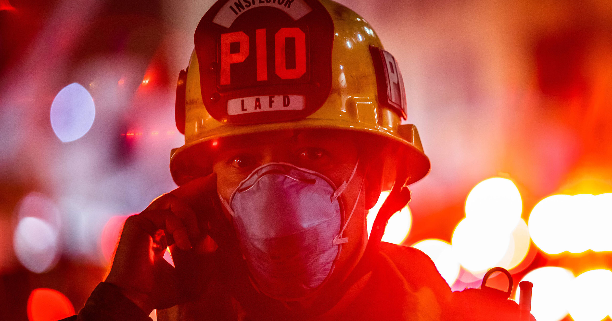

# 特斯拉让消防员出事时打两条不同的客服热线，消防界直呼离谱

> 特斯拉给应急人员的指导文件要求：消防员处理一辆 Cybercab 事故时，可能要拨打两条不同的客服热线等待人工协助，而如果想把车挪开，还得先打电话申请控制权。

既没有方向盘也没有踏板的 Cybercab，让第一响应者在事故现场多了打电话、看触摸屏、认电路线的一堆额外任务。

## 一辆没有方向盘也没有踏板的出租车

消防员和急救人员早就对 Robotaxi 颇有怨言，而特斯拉那辆金光闪闪、没有方向盘也没有踏板的 Cybercab，只会让他们的日子更难过。

根据这家马斯克旗下车企发布的新版指导文件，消防员在面对一辆出事故或需要处置的 Cybercab 时，可能需要打的不是一条，而是两条不同的特斯拉客服热线，然后等员工来协助处理请求——对一个分秒必争的职业来说，这套流程笨重得离谱。

如果消防员还得亲自把这辆车挪开，过程更加折腾。别忘了 Cybercab 没有方向盘和踏板，按指导文件，要控制它，首先得打电话联系客服来取得车辆控制权，然后应急人员才能访问它的虚拟车载控制界面——而这些显然都放在一块触摸屏上。试想戴着厚重手套去点触摸屏是什么体验。

这套文件没说出口的前提是：特斯拉基本指望消防员在实际出警之前，就已经把这些细节和更多车辆知识熟记于心，仿佛他们手头的事情还不够多。特斯拉「贴心」地表示，已在 Cybercab 挡风玻璃左下角贴了二维码，方便应急人员临场回忆该怎么做。

## 一份需要提前背下来的清单

消防员需要提前掌握的其他细节还有一大堆：必要时剪断哪几根线缆才能彻底让车辆断电、如何打开外侧没有把手的车门、如何让它靠边停下、如何把它围困住使其无法移动。安全方面则包括：车辆即使静止不动、自动驾驶指示灯也已熄灭，它可能仍处于自动驾驶模式；以及为了点亮中控触摸屏而尝试用低压方式给车辆通电，可能会引发火灾。

前消防局长、佛罗里达大学设计学院消防与应急服务主任 Jeffrey Lindsey 对 Fast Company 表示，这可能给第一响应者压上了过多的额外责任。

> 「当你抵达事故现场，最开始的主要关注点是现场安全，确保一切安全。你要通盘观察整个现场，搞清楚到底发生了什么。」他说。很多时候，赶到现场的只是一名响应者，而打电话给支持中心求助，等于在本就「塞满待办事项的盘子」上又加一件事。

## Waymo 已经演示过这套麻烦

Waymo 的 Robotaxi 早已表明，这类自动驾驶车可以成为第一响应者的挫败来源。今年早些时候，旧金山应急管理局就抱怨，警方和消防员被指望充当那些抛锚 Waymo 的「高级路边救援」。这番话说在一场听证会期间，讨论的正是去年 12 月全城停电时，这家 Robotaxi 公司在湾区的车队如何陷入混乱——失去信号灯指引的车辆不知所措，扎堆堵在路口阻碍交通。

Cybercab 是这一问题最极端的新形态，因为它连传统的驾驶控制装置都没有。或许正如一位专家所建议，Robotaxi 厂商需要为第一响应者制定某种全行业通用的标准操作流程。

> 「在我看来，核心问题在于需要通过独立研究，制定标准化、不依赖单一厂商的应急响应规程。」——纽约大学研究技术与消防科学的教授 Prabodh Panindre 对 Fast Company 说。他补充，这些规程最好应与应急响应人员共同制定。
