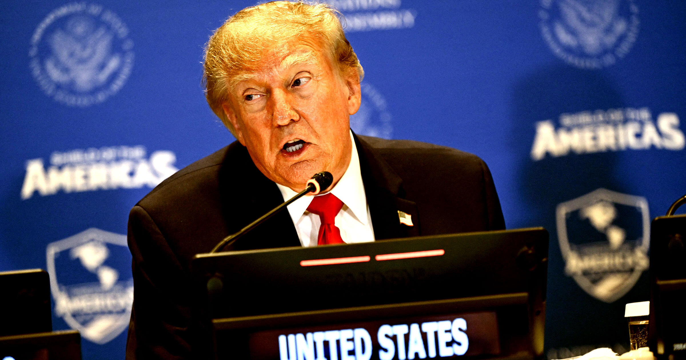

# 特朗普在联合国开口就说：不用管 AI 了，毕竟放任不管的策略在气候问题上效果不错

> 特朗普在纽约联合国大会的演讲中，开门见山地攻击了任何呼吁 AI 开发限速或暂停的人。他的理由令人咋舌：近乎完全的放手不管政策在环境问题上多好，何不复制到 AI 领域？顺带儿，他还正式给 AI 改了个新名字——「超级智能」（super intelligence）。

特朗普用「超级智能」取代了「人工智能」的说法，同时拿气候政策的「放任」成效为由，拒绝联合国层面的 AI 监管。

## 「美国完全拒绝任何全球主义人工智能控制方案」

近期的新闻里充斥着美国 AI 监管大辩论。如果你稍微关心过新闻，你一定感受到了。事实上，加强 AI 监管在美国跨政治光谱的民众中都有极高人气——只是目前的当家人Donald Trump不喜欢这个主意。

今天，纽约联合国大会期间，Trump在各国元首及其代表团面前，猛烈抨击了任何想要给 AI 开发设置限速或减速的人。他的理由非常出人意料：近乎完全的不监管政策在环境问题上奏效得很好，他藉此暗示，为何不在 AI 领域复制这一成功？

「美国……完全拒绝任何试图构建全球主义方案来控制如今被如此热议的人工智能的行为，」Trump 对各国元首和代表团绕口地说道。「但是，那些曾经说我们 12 年后都会死于全球变暖——后来名字摇身一变成了『气候变化』，因为地球其实是变冷而不是变暖，而且根本没人死——的那些人，如今又在说 AI 会杀死我们所有人，机器人会攻击我们，一切都会彻底毁灭。」

## 从「人工智能」到「超级智能」：特朗普的命名学

Trump还借这个机会，把 AI 的说法从 artificial intelligence 重新命名为「超级智能」（super intelligence）。

「今后，正式称为『超级智能』——更改名字——『人工』这个词让智能显得是假的，听起来像是假的。其实不是假的，实际上很神奇——但我们必须小心，」Trump 语无伦次地说道，这似乎与他此前声称没有什么可担心的言论背道而驰。「换句话说，欢迎来到超级智能的新世界。」

## 气候问题没人死？夏天那些极端天气呢

这里值得拆解的地方有几个。首先也是最明显的一点：气候变化正在全球范围内真实地杀害人们。今夏暴露出的极端热浪、冰川融化引发的几乎滑坡、长期干旱导致的毁灭性野火——仅举其中几例。

也许难怪特朗普总统不承认这些事件的存在：他得先亲眼看到它们才行。作为地球上最富国度里极其富有的人，Trump 不太可能与这个快速变暖世界里的受害者有过任何交集——而这些受害者，正是分布在全球最贫困、最落后的地区。

## 富人企业家们已弃绿色资本主义，投向「钻探，宝贝，钻探」

Trump 的评论还从另一个角度展示了他的社会经济视角。他坚称气候运动已经转向了下一个本周焦点 AI，但实际上，气候运动仍然活跃在草根组织、国际联盟和学术圈里。真正改变的，是美国企业和亿万富翁们的态度——他们坚决切断了绿色资本主义的路径，转向拥抱 Trump 的「钻探，宝贝，钻探」（drill baby, drill）能源体制。

通过把气候变化和 AI 担忧都轻飘飘地一挥，称之为歇斯底里的标语口号，Trump 向联合国发出信号：他打算对这两个问题都视而不见——而这一声明，把世界其他国家留给了承担他那个国家的种种麻烦的后果。
