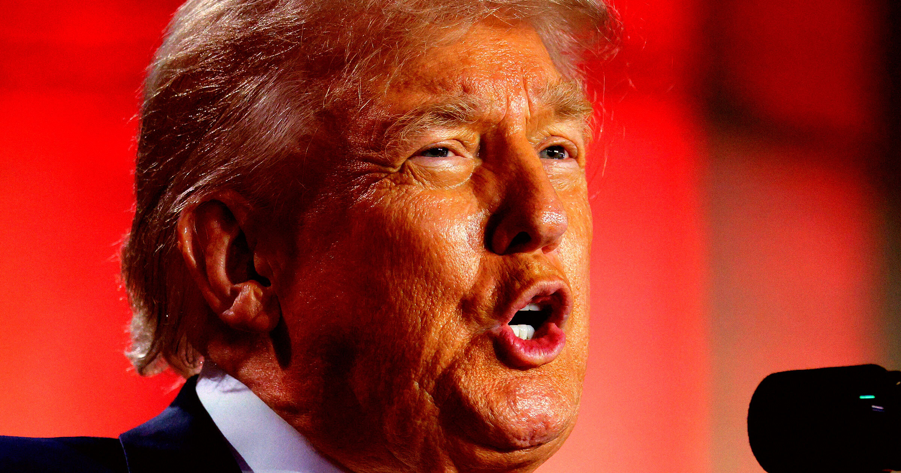

# 特朗普在联大宣布：美国官方文件今后把AI改叫"超级智能"

> 特朗普在联合国演讲中宣布，今后美国所有官方文件都将用"超级智能"取代"人工智能"，并希望全世界跟进。而他在Truth Social上最初给这个新现象提的名字，是 Superior Intelligence、Extreme Intelligence 和 Supreme Intelligence 一串候选。

特朗普借助联大演讲，为"人工智能"这个词定了一个官方新叫法。

## 一条"凭空冒出来"的帖子

特朗普又下场参与AI辩论了，方式是给AI改个名字——他认为AI不该被叫作AI。

周六，他在自己的社交平台Truth Social上发帖写道："很多人认为'人工智能'（Artificial Intelligence）这个词不准确，而且相对于AI来说非常不优雅。对这一新现象而言，远为优雅和准确的描述应该是 Superior Intelligence（SI）、Extreme Intelligence（EI），或者 Supreme Intelligence（SI）。"

这条帖子的出现似乎毫无由头。

## 联大演讲上的正式宣布

而在周二，他利用在联合国的演讲把这个说法正式化了。

"从现在开始，美国的所有文件——也希望是全世界的文件——都将改用'超级'（super）这个远比'人工'（artificial）更准确的词，"他说，"所以，是超级智能。"

这非常特朗普：他热衷于给东西重新命名，而且常常是带贬义的那种，专门用在自己的政敌身上；他也乐于沉浸在这类没有实际意义的闲谈里，随性追着脑子里冒出的念头走。

## "人工智能"这个词到底哪里"不优雅"

问题是，"很多人"真的认为"人工智能"一词"不准确"或"不优雅"吗？如果有，原因也不是特朗普所假设的那样——恰恰因为这个词把某种并不真正智能的东西拟人化了，而不是因为它其实是一种超级无敌的智能。

另一种可能是，特朗普已经完全接受了硅谷人物推销的"人工超级智能"叙事：一种近乎邪教式的信念，认为人类即将造出神一般的机器，它要么带来乌托邦式的好处，要么毁灭人类。这套AI生存风险叙事近期再度升温——Anthropic 首席执行官 Dario Amodei 呼吁为AI发展减速，起因是该公司的前研究员指责AI行业在"拿我们的命赌博"。

## 他本来就和AI生成内容深度绑定

别忘了，特朗普本人也是AI垃圾内容的重度使用者：他用AI生成过把自己描绘成神祇的图像，甚至生成过自己当战斗机飞行员、朝抗议者喷射腹泻物的画面。更恶劣的是，他还用AI生成过美国在对伊朗战争中大获全胜的假画面。对于一个执着于用谎言改写现实的人来说，AI大概确实像是天赐的超级智能。

特朗普也不是他这届政府里第一个给AI提出惊人别称的人。去年，他的教育部长 Linda McMahon 在一场活动上，反复把这门技术称为"A1"——就像那款牛排酱品牌的名字。
