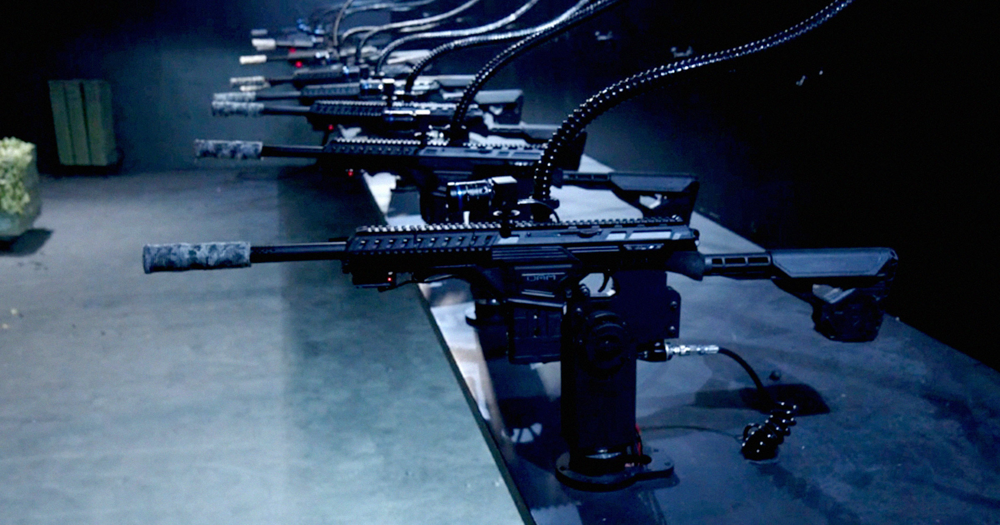

# 网上开枪嗨翻——Shov 网站让你远程操控真枪打靶

> 你没看错——一个刚上线的名叫 Shov 的网站，允许用户在浏览器里远程操控一排真正的气动枪械对准靶子开火。弹药是硬化橡胶做的「低致死性」弹丸，警察误用时可杀人。

Shov 网站示意图：12 门气动枪械并排安装在金属结构上。图/Victor Tangermann

## 躺在沙发上开枪：Shov 是怎么回事

从前要开枪，你得去靶场、找人指导、办手续。现在？你甚至不需要起身。Shov.com 刚公开上线，用户可以在浏览器里遥控一门真正的武器。这些气动枪发射的是 .68 口径硬化橡胶「低致死性」弹药——当警察部署它们时，已知造成 global 范围内数十人死亡、数千人受伤。

这个项目的发 출시할 时机堪称 도발적이다. 远程操控武器如今已是现实战场上的常见景观。2021 年，以色列曾用类似的远程枪暗杀伊朗顶级核科学家；乌克兰的双方军队用载有爆炸物的无人机作武器，甚至已走到让 AI 自主武器无需人类干预就能识别并打击目标的地步。

Shov 本身当然没在重现现代战争那堪比哀痛的 horror，但光是「允许任何人操控一门本可装上致命突击 rifle 的 gun 塔雷」这个前제，就自带沉甸甸的黑色 baggage。

## 现场直播：12 门枪同时开火的声音

Shov 的实时直播画面展示了一个长条形金属结构，上面挂着十二门 .68 口径气动枪，各自独立瞄准并开火。开声音的话，你会听到一阵耳膜环球的密集射击声，外加一个低沉的、像电子游戏里才有的男声，报出每一轮 90 秒的开始与结束。

要掌控其中一门枪，玩家得花 5 美元购买 5 个积分，然后在屏幕上瞄准圆形靶子——击中后靶子由绿转红。

## 作者亲自试玩：在沙发上感受真枪的重量

作者在上线前获得了试玩机会，体验后只觉得摸不着头脑。进了候车室 30 秒后，作者控制了塔雷，用鼠标点击散布在「竞技场」里的绿靶——那里摆着摩托车和模特，枪却似乎拒绝向它们射击。

「Range hot, real gun turrets, click to shoot green targets」，那男低音宣告道，「Most kills win」。

## 不是火药，是高压空气——在线卡尼拍射击场

Shov 创始人 Domm Holland 邮件里写给 Futurism：「gun 塔雷靠的是『极高压空气，不是火药』。」

换句话说，这个项目很多方面其实就是一个在线卡尼拍的射击场。仔细一看，每门枪上都可以看到连接着软管、供给圆形弹药的管线。

「我们让货厂给我们制造這些，它們主要是硬化橡膠」，Holland 指着弹药并附了一张被其中一发击凹的標牌照片告诉 Futurism，「但極硬」。

## 不需要人类也能打靶——AI 选手填满空位

这款游戏技术上甚至不需要人类来开靶。

「任何空座位都会分配一名 AI 玩家，标注为 [AI]——所以每一轮都是 12 塔雷的全面火拼」，公司网站底部一条细小的通知这样写道。

右侧面板显示了实时玩家正在积极瞄准靶子。上线前，每个展示的玩家都附有一张光线异常柔和的自拍——恰恰是作者在报道互联网越来越浑浊的内容时屡次见识到的那种 AI 生成头像。

## 作者的结语：还好我没真在操控 lethal 武器

作者私下觉得庆幸自己并没有真的在操控 lethal 武器——哪天他也不打算这么做。暂时他也乐意把射击声局限于电子游戏里——比起在浏览器里点击绿靶，这可是高多了的性价比提案。
