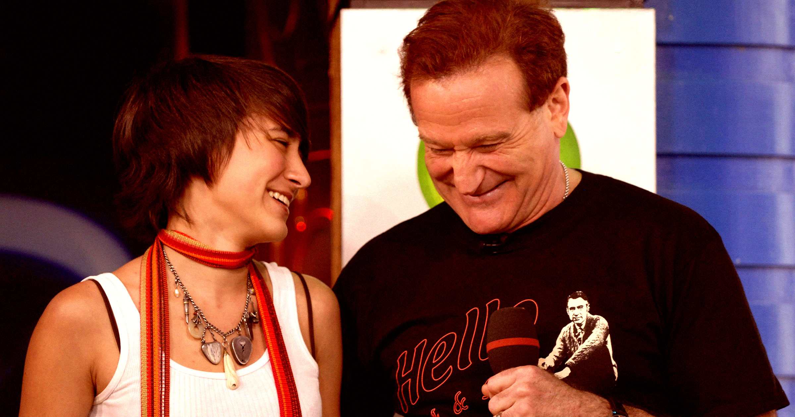

# 罗宾·威廉姆斯的女儿怒斥：别再拿 AI 伪造我父亲的阴谋论视频

> 罗宾·威廉姆斯去世近十年后，AI 伪造的“生前私密录像”阴谋论视频在 X 上被转发数千次，他的女儿 Zelda Williams 公开发声怒斥。

AI 伪造的“罗宾·威廉姆斯私密录音”在社交平台上被转发数千次，他的女儿 Zelda Williams 直言那是又机械又糟糕的假声音。

## “那明显是 AI，而且做得一点都不像”

去世将近十年后，传奇喜剧演员 Robin Williams 正以一种最糟糕的方式被人们记住：社交媒体上那些令人昏昏欲睡、由 AI 生成的“致敬”视频，被轻信的网络用户毫无节制地转发。他尚在人世的女儿、电影导演 Zelda Williams 看着这一切，感到愤懑。

> “我被人拿来看的那段所谓“私密视频”里，父亲在谈论阴谋论——那明显是 AI 生成的，而且做得一点都不像。任何自称粉丝却相信它的人，显然是把他的电影静音看完的，因为那个声音又机械又糟糕。”——Zelda Williams，在 X 上发文

在马斯克执掌的社交平台上稍作搜索，就能找到一段 13 秒、画质模糊的视频：AI 生成的 Robin Williams 声称自己“在这个行业待了很久”，还说“见过一些事”。无法立即确认这就是 Zelda Williams 所指的那条，但以它流传之广，可能性很大。

视频里，AI 版的 Williams 还带着阴谋论的口吻说：“真正的精英，站在最顶端的那批人，他们玩的不只是权力游戏，他们崇拜某种更黑暗的东西。”正如贴在这条视频上的社区注释所指出的，这是一个深度伪造，却谎称“展示了 2013 年 Robin Williams 的一段私人录音”。即便如此，它仍被转发了数千次，收获超过 1.1 万个赞。

## “他已经不在了，不代表他成了你的木偶”

在声明中，Zelda Williams 直接把矛头对准了传播这些内容的人。

> “话虽如此，是活人让机器造出了它。对你们我想说：别把他拉进你们那套妄想里的垃圾话，让他安息。如果你连自己的观点都没法不靠一个死人来增强说服力，那我倒要问：现在究竟是谁在通过媒体操纵公众？”——Zelda Williams

她也毫不掩饰对马斯克这个平台的厌恶，这里早已以助长虚假信息和仇恨言论而闻名：“我讨厌这个粪坑一样的应用。现在它基本上就是一堆机器人和甘愿被机器人骗的人，所以我也不知道自己为什么还要回来澄清这些，但我爱他，所以我会回来。”

“他走了，不代表他就成了你的提线木偶，”她补充说，“要点脸。”

## 这不是她第一次发声

这远不是她第一次表达愤怒。2023 年，她就说那些用来模仿父亲声音的 AI 模型让她“个人层面感到不适”。两年后，文本生成视频工具流行起来，她又发出过一次类似的恳求。

> “拜托，别再给我发父亲的 AI 视频了。别再以为我想看，也别以为什么都不懂的我总会理解——我不想看，也不会理解。”——Zelda Williams，2025 年
