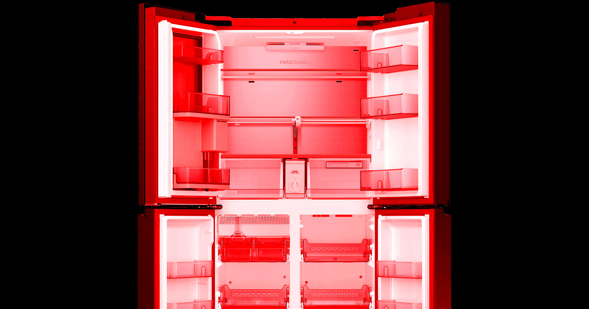

# 三星"AI冰箱"软件更新后变成废砖

> 三星"Bespoke AI 4-Door"冰箱——售价近4000美元——在一次故障固件更新后突然宕机，韩国用户在中秋节前夕发现冰箱已无法制冷，不得不丢掉节日特备 delicacies。

三星宣称"AI驱动"的高端冰箱在一次软件更新后彻底变砖，韩国家庭损失惨重。

## 三星家电：出了名的容易坏，而且修起来贵得离谱

老百姓心里早就有数：尽量别碰三星家电。它们出了名的频繁出问题，而且维修要么贵到心碎，要么干脆没得修——何况修了也未必管用。

结果，一种完全不必要、令人发噶的"AI注入"，让更多倒霉的三星"Bespoke AI 4-Door"冰箱用户吃尽了苦头。韩国各地的用户发现，他们差不多4000美元的电器突然在一次 faulty 固件更新后关机，变成了一个昂贵又容易坏食物的砖头。

根据《Star News Korea》的报道，内置的面板屏幕几个小时都在显示错误信息。即便拔了电源再插回去，也没能解决问题——冷气继续跑掉。

## 厂家答应的最早维修日期：10月1日，中秋已经过了

最糟的是，这次故障刚好发生在 Chuseok（中秋节）假期前夕——一个庆祝丰收满月、持续三天的传统节日。有的用户说他们不得不扔掉提前准备好的节日盛宴 delicacies。

雪上加霜的是，愤怒的用户被告知最早的上门服务日期是10月1日——早已过了假期。

## 三星 자기家冰箱都不知道里面有啥，靠"AI"推荐食谱？

这一令人气愤的事件完美说明了即便是生活最平常的方面，也正在被 OTA（Over-The-Air）软件更新感染的噩梦所吞噬，而且完全是违背用户意愿的。

三星宣称它那些自称"Smart"的冰箱知道自己里面有啥，能推荐食谱，甚至还能放音乐——全拜"AI"之功。Futurism敢打赌，几乎没有用户曾经摸过这些功能。

毕竟，电冰箱已经问世一个多世纪了——它是现代生活一个重大而且基本不复杂的奢侈品，几十年来其核心功能没怎么变过。

## 不止是冰箱，AI 正在毁掉一切家电

被时髦科技搞坏的还远不止冰箱。我们也见过严重过度工程化的 AI 牙刷、AI 吐司机，还有 creepy 得要死的带面部识别功能的 AI 门铃。

庆幸的是，消费者在选购家电时还有不少选择。但随着越来越多的公司押注 AI、坚持把这玩意集成到生活的方方面面，让我们的日子过得更痛苦，更可靠的替代方案迟早会变得越来越难找。

---

**原文：** Software Update Turns Samsung's "AI Fridges" Into Useless Bricks
