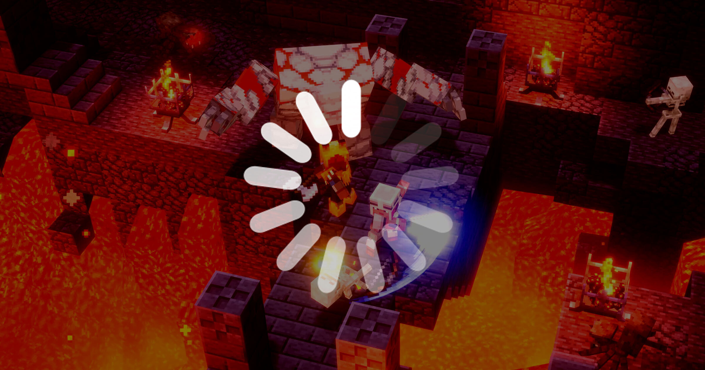

# 微软专利曝光：游戏过程中「无缝」插入广告的技术，boss 战、加载屏、过场动画都是广告节点

> 微软最新专利曝光了一套「广告积分」系统：游戏引擎会根据 boss 战、加载屏、过场动画等自然节点，自动暂停游戏并插入视频或静态广告——玩家以为只是出现了一个正常的游戏节奏转换，实际上正坐在广告座上。

微软的专利让游戏中的 boss 战、加载画面等节点变成广告插播的时机——玩家几乎无法察觉。

## 广告积分系统：靠游戏信号决定插播时机

想借着逃离日益反乌托邦的现实世界，跑进虚拟世界里喘口气？微软的新专利可能让这件事没那么简单。

据 Respawn First 报道，微软最近公开了一项名为「广告积分」（ad credit）的全新专利申请。这套系统的核心思想是：依靠游戏引擎传递出的信号，来选择最恰当的时机向玩家推送游戏内广告。

具体来说，这些广告节点会因游戏而异，但大多数情况下会锁定一些游戏里天然存在的事件——比如 boss 战、加载画面、离开过场动画的瞬间等等。当系统接收到一个正向信号，它就会立刻将游戏暂停，在屏幕上呈现一段视频广告或一张静态图片。与此同时，一个倒计时定时器也随之重置——等定时器归零，系统又会重新开始扫描下一个游戏内的信号节点。

## 专利文件里的 reasoning：交互式内容更难预测

微软在专利文档里写道：「在非交互式视听内容中，这种周期性中断可以放在内容里的多个可预测节点，而不会对用户体验产生负面影响。但交互式软件应用程序在流式传输交互式视听内容时，能提供更丰富的用户体验，而预测何时暂停交互并呈现推广的视听内容，充满挑战。」

这套系统名叫「Contextually Aware Management of Interactive Software Application Access」（情境感知的互动软件应用访问管理）。目前还不知道微软是否已经开始在游戏中部署这套系统，或者说是否有部署的计划。

## 看似针对免费游戏，实则可能蔓延到付费(title)游戏

Respawn First 指出，这套系统看起来主要瞄准的是 Xbox 和 PC 上的免费游玩（free-to-play）游戏。但也顾及到一个现实：随着出版社主导的机制（比如微交易）慢慢渗透，情境感知广告系统迟早会走进付费游戏标题里——仅仅是时间问题。

玩家买了一款游戏，付钱进了虚拟世界，谁想到里面还能继续被广告追着跑呢。
